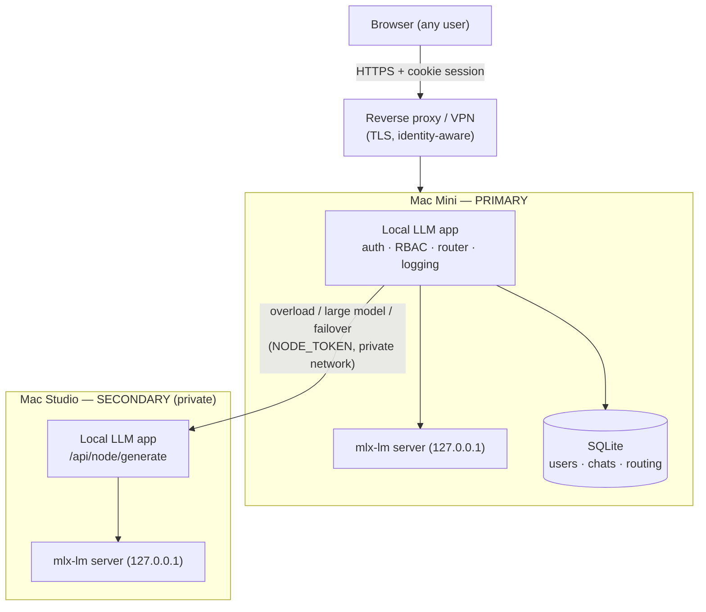

# Local LLM — self-hosted, multi-user agent for Apple Silicon

A private, self-hosted LLM assistant that runs on your own Apple Silicon Macs.
It combines a model server manager, a tool-using agent, a glass-box web chat UI,
a feedback/LoRA training loop, and a task scheduler — and adds
**authentication and multi-user isolation**, **admin/non-admin roles**,
**Microsoft Entra ID (OIDC) login**, **structured logging with correlation IDs
and secret redaction**, **conversation-history import from Claude, ChatGPT,
DeepSeek and xAI**, **named agent profiles with per-agent capabilities**
(including Office 365 over Microsoft Graph), and **automatic Mac Mini → Mac
Studio routing and failover**.

It stays true to its original constraint: fit big work into small RAM by
splitting it into bounded steps, slowing down rather than crashing.

## Table of contents

- [Overview](#overview)
- [Requirements](#requirements)
- [Installation](#installation)
- [Configuration](#configuration)
- [Authentication, users and roles](#authentication-users-and-roles)
- [Microsoft Entra ID / OIDC](#microsoft-entra-id--oidc)
- [Conversation history import](#conversation-history-import)
- [Agents, knowledge and skills](#agents-knowledge-and-skills)
- [Feedback and LoRA retraining](#feedback-and-lora-retraining)
- [Agent profiles and capabilities](#agent-profiles-and-capabilities)
- [Office 365 (Microsoft Graph)](#office-365-microsoft-graph)
- [Multi-turn task continuity](#multi-turn-task-continuity)
- [Performance and resource limits](#performance-and-resource-limits)
- [OpenAI and Anthropic compatible API](#openai-and-anthropic-compatible-api)
- [Logging and debugging](#logging-and-debugging)
- [Automatic Mac Mini / Mac Studio routing](#automatic-mac-mini--mac-studio-routing)
- [Mac Mini deployment (primary)](#mac-mini-deployment-primary)
- [Mac Studio deployment (secondary)](#mac-studio-deployment-secondary)
- [Secure internet access](#secure-internet-access)
- [Search provider](#search-provider)
- [Production hardening checklist](#production-hardening-checklist)
- [Testing](#testing)
- [Troubleshooting](#troubleshooting)

---

## Overview

Two processes cooperate on each machine: the Python app (web server, agent, DB,
trainer, router) and the `mlx-lm` model server it supervises. The browser talks
only to the Python app.

**Components**

- **Web server (FastAPI).** Serves the single-page UI and a JSON/SSE API. All
  routes are authenticated and role-checked server-side.
- **Auth layer.** Cookie-based sessions, scrypt password hashing, admin/non-admin
  roles, first-run admin bootstrap, an optional test user, and Entra ID / OIDC
  single sign-on. See [`local_llm/auth.py`](local_llm/auth.py).
- **Agent.** A model-as-router reasoning-and-tools loop over the local model.
- **Cluster router.** Classifies each request, picks the best node (Mac Mini
  primary / Mac Studio secondary) on live load, health and model capability, and
  fails over — no machine is ever chosen by the user. See
  [`local_llm/cluster.py`](local_llm/cluster.py).
- **SQLite database.** Conversations, feedback, memory, metrics, tasks, users,
  sessions, imports and routing telemetry — every user-owned row carries an owner
  so users are isolated. See [`local_llm/database.py`](local_llm/database.py).
- **Structured logging.** JSON logs with a correlation id per request, secret
  redaction, rotation and retention. See [`local_llm/obslog.py`](local_llm/obslog.py).
- **History import.** An admin uploads a chat-export ZIP from Claude, ChatGPT,
  DeepSeek or xAI; it is validated, safely extracted, parsed, de-duplicated,
  stored as browsable history and indexed for retrieval. See
  [`local_llm/claude_import.py`](local_llm/claude_import.py).
- **Agent profiles.** Named agents, each with an explicit capability set that
  becomes a concrete tool allowlist; several can answer one prompt in parallel
  and have their answers merged.
- **Trainer & scheduler.** LoRA fine-tuning from feedback, and named tasks the
  agent runs on demand or a timer.
- **Web UI.** One embedded single-page app (no build step, no bundler) in the
  `local_llm/ui_*.py` modules, assembled once at import. Every option lives under
  **Settings**, grouped into collapsible sections (Appearance, Generation, Agent,
  Models & training, Performance, Memory, Tools); admin-only panels are split into
  sub-tabs so the screen stays uncrowded. Light and dark themes are both first
  class.

**Architecture (two nodes)**



Everything works on a **single machine with auth disabled** exactly as before —
the multi-user, multi-node and auth features are additive and off by default.

---

## Requirements

- **Apple Silicon Mac(s)** (M1 or later). The backend is `mlx-lm`, Apple-Silicon
  only. Two Macs (a Mini and a Studio) for the routing/failover setup; one is fine.
- **Native arm64 Python 3.10+**. `--selftest`, `--doctor` and `--list-models`
  also run on non-Apple hardware (without the model server).
- **Dependencies** (installed automatically into `./.venv` on first run):
  `mlx-lm`, `fastapi`, `uvicorn`, `httpx`, `pydantic`. Document generation
  (PDF, Word, Excel, PowerPoint) is built in and needs nothing extra. Optional:
  `python-multipart` (browser file uploads to the knowledge base),
  `PyJWT`+`cryptography` (extra OIDC signature verification), `psutil` (memory-%
  routing signal), `pytest` (test suite).
- **Network**: model downloads (Hugging Face) and the DuckDuckGo Lite search tool.
  The UI also requests its heading font from Google Fonts; if that is blocked the
  page falls back to the system font stack and everything else works unchanged.
- **Microsoft**: an Entra ID app registration if you want org SSO (optional).

---

## Installation

**One line** (macOS on Apple Silicon; it never uses sudo):

```bash
curl -fsSL https://raw.githubusercontent.com/zeno-b/native-silicon-local-llm/main/install.sh | bash
```

The installer checks for native arm64 and Python 3.10+ (it suggests
`brew install python@3.12` when there is none), clones the repository into
`~/local-llm` (`--dir` to change it) or fast-forwards an existing checkout, and
runs `deploy.py init`. Options go after `bash -s --`, for example
`... | bash -s -- --multi-user --service`:

| option | effect |
| --- | --- |
| `--multi-user` | require login, bind all interfaces, generate an admin password (printed once) |
| `--service` | install the launchd LaunchAgent: starts now and at login, restarts after a crash |
| `--cluster primary` | multi-user plus a generated `NODE_TOKEN` |
| `--join URL --code CODE` | make this Mac a secondary of the primary at URL (pairing code from its Settings > Cluster) |
| `--model ID`, `--host HOST` | override the recommendation |
| `--force` | regenerate an existing `.env` (the old one is kept as `.env.bak`) |
| `--dry-run` | print every action without running it |

Re-running is safe: it updates the checkout, refreshes the dependencies and keeps
your `.env`. Run from inside a checkout (`./install.sh`), it uses that checkout. A
HEAD-only Homebrew formula also exists; [packaging/README.md](packaging/README.md)
explains where it keeps data and why install.sh is the recommended path.

**By hand:**

```bash
git clone https://github.com/zeno-b/native-silicon-local-llm.git
cd native-silicon-local-llm

# 1. Configure. init creates ./.venv, installs the dependencies and writes .env
#    for this Mac: the model that fits its RAM with headroom, its context window
#    and admission limits. Add --multi-user to require login.
python3 deploy.py init

# 2. Run. The first launch downloads the model and initialises the SQLite
#    database (schema + migrations) automatically.
python3 deploy.py
```

`deploy.py init` never overwrites an existing `.env`: it writes `.env.new` beside
it and prints what differs (`--force` replaces it and keeps `.env.bak`). Without
init, copy `.env.example` to `.env` and edit it; every variable is optional and
the defaults scale with RAM.

The app prints the detected RAM, the chosen model and context window, and the URL
to open (a free port is picked if the preferred one is busy). `deploy.py` and
`python -m local_llm` read `.env` (or the file `LOCAL_LLM_ENV_FILE` names)
themselves before anything else, so no `export` is needed. A variable already set
in the environment wins over the file, and `LOCAL_LLM_DOTENV=0` turns the file
off. Values are literal (no `$VAR` expansion) and switches are `1`/`0`:
`AUTH_ENABLED=true` reads as off, which `--doctor` flags.

**Run at login:** `python3 deploy.py service install` writes
`~/Library/LaunchAgents/local.llm.server.plist`, which runs `.venv/bin/python
deploy.py` from the checkout, restarts it after a crash and logs to
`logs/service.*.log`. `service status` reports on it (read only) and
`service uninstall` removes it.

**Health check:** `python3 deploy.py --doctor` reports the ports, then checks the
Python architecture, the venv, whether the configured model is downloaded, free
disk, RAM against the model's size, and `.env` (parse errors, `true`/`false`
switches, permissions).

**Development mode** (single user, no login):

```bash
python3 deploy.py --agent        # auth off by default
```

**Production / multi-user mode**:

```bash
AUTH_ENABLED=1 AUTH_ADMIN_USERNAME=admin AUTH_ADMIN_PASSWORD='choose-a-strong-one' \
  python3 deploy.py
```

**Admin creation.** On first start with `AUTH_ENABLED=1`, an admin is created from
`AUTH_ADMIN_USERNAME`/`AUTH_ADMIN_PASSWORD`. If no password is set, a strong one is
generated and printed to the log **once** — save it and change it after logging in.
Re-running never resets an existing admin's password.

**Test user** (optional, for dev): set `AUTH_ALLOW_TEST_USER=1` and
`AUTH_TEST_PASSWORD=…`. It is a normal non-admin account, not a backdoor. Remove
it for production by setting `AUTH_ALLOW_TEST_USER=0` (it will not be recreated) or
deleting it from the admin **Users** panel.

**Database.** SQLite at `data/feedback.db`, created and migrated on startup. The
migration is additive and idempotent: existing single-user data is backfilled to a
`local` owner, so upgrading in place keeps every conversation.

---

## Configuration

All configuration is centralized in [`local_llm/config.py`](local_llm/config.py)
and driven by environment variables; [`.env.example`](.env.example) documents
every variable with placeholders. Highlights:

| Group | Variables |
|-------|-----------|
| Model/core | `MODEL_ID`, `CONTEXT_SIZE`, `MAX_TOKENS`, `TEMPERATURE`, `HISTORY_TURNS`, `WEB_PORT`, `MODEL_PORT` |
| Logging | `LOG_LEVEL`, `LOG_FORMAT`, `LOG_DIR`, `LOG_CHAT_CONTENT`, `LOG_MAX_BYTES`, `LOG_BACKUP_COUNT`, `LOG_RETENTION_DAYS` |
| Auth | `AUTH_ENABLED`, `AUTH_ADMIN_USERNAME`, `AUTH_ADMIN_PASSWORD`, `AUTH_SESSION_TTL_HOURS`, `AUTH_COOKIE_SECURE`, `AUTH_ALLOW_TEST_USER`, `AUTH_TEST_USERNAME`, `AUTH_TEST_PASSWORD`, `LOGIN_MAX_FAILURES`, `LOGIN_WINDOW_S` |
| Entra/OIDC | `OIDC_ENABLED`, `OIDC_TENANT_ID`, `OIDC_CLIENT_ID`, `OIDC_CLIENT_SECRET`, `OIDC_REDIRECT_URI`, `OIDC_ADMIN_EMAILS`, `OIDC_ADMIN_GROUPS`, `OIDC_ADMIN_ROLES`, `OIDC_DEFAULT_ROLE` |
| Office 365 | `O365_TENANT_ID`, `O365_CLIENT_ID`, `O365_CLIENT_SECRET`, `O365_SCOPES` |
| Cluster/routing | `NODE_ROLE`, `NODE_NAME`, `STUDIO_NODE_URL`, `NODE_TOKEN`, `ROUTE_MAX_ACTIVE`, `ROUTE_QUEUE_DEPTH`, `ROUTE_CPU_PCT`, `ROUTE_LOAD_RATIO`, `ROUTE_MEM_PCT`, `ROUTE_SLA_MS`, `ROUTE_COOLDOWN_S`, `LARGE_MODEL_MARKERS`, `HEARTBEAT_INTERVAL`, `HEARTBEAT_TIMEOUT`, `NODE_PROBE_TIMEOUT` |
| Admission control | `MAX_CONCURRENT_GENERATIONS`, `GENERATION_QUEUE_DEPTH`, `ADMISSION_MEMORY_AWARE`, `ADMISSION_MIN_FREE_MB`, `MAX_CONCURRENT_TASKS`, `AGENT_RUN_TIMEOUT` |
| Inference backend | `MODEL_BACKEND`, `DRAFT_MODEL`, `NUM_DRAFT_TOKENS`, `BACKEND_COMMAND`, `BACKEND_CAPABILITIES`, `BACKEND_EXTRA_ARGS` (see [Inference backends](#inference-backends)) |
| Model catalogue | `MODEL_ALIASES`, `BENCH_MIN_DECODE_TPS`, `BENCH_HEADROOM_GB` (see [Model catalogue](#model-catalogue-aliases-and-the-benchmark-sweep)) |
| Multi-node / remote | `CLUSTER_NODES`, `CLUSTER_HOSTFILE`, `CLUSTER_PYTHON`, `WEB_HOST`, `TRUSTED_PROXIES`, `PUBLIC_BASE_URL`, `NODE_CA_FILE`, `NODE_CLIENT_CERT`, `NODE_CLIENT_KEY`, `NODE_ALLOW_PLAINTEXT`, `NODE_E2E_KEY` |
| Tool-call parsing | `TOOL_CALL_FORMAT`, `TOOL_CALL_REPAIR` (see [Tool-call formats](#tool-call-formats)) |
| Tool approvals | `APPROVAL_DEFAULT_MODE`, `TOOL_APPROVAL_MODE`, `TOOL_APPROVAL_UNATTENDED`, `TOOL_APPROVAL_TIMEOUT_S`, `TOOL_APPROVAL_TAINT`, `TOOL_APPROVAL_ROLES` (see [Tool approvals and audit](#tool-approvals-and-audit)) |
| OpenAI / Anthropic API | `V1_DEFAULT_MODE`, `V1_RAW_ENABLED` (see [OpenAI and Anthropic compatible API](#openai-and-anthropic-compatible-api)) |
| Agent/tools | `AGENT_ENABLED`, `AGENT_ESCALATION`, `AUTO_CONTINUE`, `AUTO_CONTINUE_MAX`, `AGENT_MIN_STEPS`, `AGENT_MAX_STEPS`, `AGENT_TOOLS`, `CODE_MAX_TOKENS`, `PROJECT_DIR`, `ALLOW_SHELL`, `ALLOW_PYTHON`, `FILE_DENY_GLOBS` (paths no file tool, @reference or download may touch), `OUTPUTS_DIR` (where `create_document` writes a bare file name, default `outputs`) |
| Retrieval and reasoning budget | `RAG_DF_CEILING` (query words in more than this share of the indexed documents, default 0.2, stop counting as relevance; from 20 documents up), `REASONING_PROMPT` (`auto`: the think-first instruction only for catalogue thinking models; `always`, `never`), `THINK_MAX_TOKENS` (reasoning tokens per agent step before it is asked for the answer only, default 384, 0 = no cap) |
| Intent lexicon | `INTENT_LEXICON_ENABLED` (default 1: the app's own terms such as knowledge base, codebase, skills, memory, history, tasks and a PDF or Word file are read as instructions before the router runs, picking the tools and retrieval for the turn; settings, conversation buttons and switched-off tools get a reply that says where to find them; slash commands `/kb`, `/docs`, `/code`, `/skills`, `/history`, `/mem`, `/pdf` map to the same intents; 0 = router only) |
| Sandbox | `EXEC_BACKEND`, `DOCKER_IMAGE`, `EXEC_ENV_PASSTHROUGH`, `EXEC_MEMORY_MB`, `EXEC_MAX_FILE_MB`, `EXEC_PIDS_LIMIT`, `EXEC_GUARDRAIL`, `TOOL_TIMEOUT`, `TEST_TIMEOUT`, `TEST_COMMAND` (see [Sandboxed execution](#sandboxed-execution)) |
| Task continuity | `TASK_STATE_ENABLED`, `TASK_ARTIFACT_CHARS`, `DRIFT_CHECK_ENABLED`, `ARTIFACT_REPLY_HEADROOM`, `DEBUG_PROMPTS` (see [Multi-turn task continuity](#multi-turn-task-continuity)) |
| Training | `TRAIN_MIN_EXAMPLES`, `TRAIN_EPOCHS`, `TRAIN_ITERS`, `TRAIN_LR`, `TRAIN_SEQ_LEN`, `TRAIN_BATCH_SIZE`, `TRAIN_NUM_LAYERS`, `TRAIN_FINE_TUNE_TYPE`, `TRAIN_LORA_RANK`, `TRAIN_TOOL_RATIO`, `TRAIN_TOOL_QUALITY`, `TRAIN_REPLAY_RATIO`, `TRAIN_VAL_SPLIT`, `TRAIN_VAL_CHECK`, `TRAIN_TIMEOUT`, `TRAIN_MAX_BACKUPS`, `AUTO_RETRAIN_THRESHOLD` (see [Feedback and LoRA retraining](#feedback-and-lora-retraining)) |
| Import | `IMPORT_MAX_ZIP_BYTES`, `IMPORT_MAX_FILES`, `IMPORT_MAX_UNCOMPRESSED_BYTES`, `IMPORT_MAX_FILE_BYTES` |
| Search | `SEARCH_RESULTS` (provider is locked to DuckDuckGo Lite) |
| Networking | `ALLOWED_ORIGINS` (extra CORS origins behind a proxy; `*` is refused) |

### Producing files

Ask for a document and you get one: **PDF, Word (.docx), Excel (.xlsx),
PowerPoint (.pptx), HTML, CSV, Markdown or plain text**. The agent writes the
body as Markdown and the `create_document` tool typesets it into the format the
extension asks for — headings, bold and italic, bullet and numbered lists,
tables, code blocks and page breaks, with page numbers on multi-page PDFs. The
file lands in the workspace (or the attached project directory) and appears as a
download link under the answer.

This is written against the file formats directly and needs **no extra
dependencies**: PDF is emitted as PDF 1.4 with the base-14 fonts, and .docx,
.xlsx and .pptx are written as OOXML packages. A capability that only works when
a wheel happens to be installed is exactly the "I can't do that" answer this app
is built to avoid, so it is always available and works offline.

"Write me a PDF of the Q3 numbers" is detected *before* routing, for the same
reason a code request is: the router would quite reasonably answer "answer", the
prompt would be rebuilt with no tools at all, and the model would write a
perfectly good report into the chat while the file you asked for was never
created. Merely mentioning a format ("summarise this pdf") is a request to read
one and is left alone, so the agent never overwrites the file you handed it.

Downloads are served by `GET /api/files/download?path=…`, which requires
authentication, resolves the path through the same confinement the file tools
use, and serves only the formats above — it is a download link, not an arbitrary
file read.

**Follow-up edits work on the document, not on a memory of it.** "Now make it in
the style of texcel.be", "add the VAT line", "now make it a Word document" name
no format, no file and no subject — what makes them document turns is that a
document is what is being worked on. So the Markdown handed to `create_document`
is recorded as the task's artifact (the rendered `.pdf` is bytes the model can
never read back) and the next turn is briefed with that source and told to
re-render the same path. A format change keeps the source and moves the file.

Telling an edit from a new document is deliberately biased toward the edit,
because losing the source is the worse mistake. A new document needs a message
that *both* fails to point back at the current one ("it", "that", "the
invoice") *and* names a subject sharing nothing with it — "now create a
powerpoint about kubernetes" starts fresh, "same thing but as a deck" does not.
A question about the document ("what does it say?") is answered, not rendered,
and a code request after a document drops the document task rather than briefing
the model to re-render it.

**Ask it to look something up and it will, before it writes.** "Look up as much
as you can find about them, then draft the document" is half the request; a
document turn that skips it produces a confident page of invented facts, which
is worse than no document. Naming a site (`www.example.be`, a URL) counts as
asking. The turn then works in two steps — search, then write — and is told to
say where the sources were thin rather than filling the gaps in.

**A document turn carries only the tools it can use.** The full catalogue is
~2200 tokens of a 4096-token window, and a turn that can only call
`create_document` was spending 1600 of them describing twenty-one tools it would
never touch — leaving barely a thousand tokens for the document to fit inside
the tool call, where it was cut off mid-JSON and no file was produced. Narrowing
the catalogue roughly doubles the room the document gets. If a call is cut off
anyway, the turn says so and asks for a shorter document rather than showing you
the half-written JSON as an answer.

`AUTO_CONTINUE` (default 1) finishes an answer that stopped at the reply limit,
without being asked. The reply budget is a property of the context window, not
of the request — a program that needs 2000 tokens on a 4096-token context is
going to be cut off however it is phrased — so printing "ask me to continue" and
stopping made finishing the work your job, one "go on" at a time, and every one
of those round trips re-prefills the whole prompt. It reuses the same
continuation lane a typed "continue" does; it just stops waiting to be asked.

`AUTO_CONTINUE_MAX` (default 3, capped at 6) is how many passes one turn may
spend. Each is a full generation, so this is a wall-clock budget as much as a
quality one. The loop also stops early when a pass adds nothing, or when two
passes in a row add the same text — a model looping a phrase should not make the
answer longer and worse. If the answer is still unfinished when the passes run
out, the turn says so and the cut-off marker stays, so a typed "continue" still
picks up where it left off. `AUTO_CONTINUE=0` restores the old behaviour.

`AGENT_ESCALATION` (default 1) lets a turn switch into agent mode partway
through. The router decides answer-vs-tool from one short call *before* the
model has seen how hard the question is, and on "answer" the prompt is rebuilt
without the tool protocol — so the turn used to be locked out of every tool for
the rest of its life, and came back with "I don't have access to real-time data"
while a working `web_search` sat one step away. With this on, a reply that
reports a missing capability (no web, no access to your files) hands the turn
its tools and spends another step instead of returning the refusal. It fires at
most once per turn, never when the tool that would help is not registered, never
when a lookup is impossible because the box is offline, and never against an
explicit `/no-search` or `/kb`. Type `/agent` (or `/tools`) in front of a message
to skip the router and start the turn in agent mode yourself.

`AGENT_MIN_STEPS` (default 2) is the thinking-depth knob. Below it the agent will
not settle on a plain-text reply: the first pass is treated as a draft, handed
back with a critique instruction, and improved on the next step. Set it to 1 to
get the old behaviour, where a turn ends as soon as the model produces anything.
Each step above 1 costs one extra generation per turn.

**Question kinds.** Every message is sorted into one of fifteen shapes before
anything else happens — code, summarize, creative, debug, math, multi-hop,
planning, decision, comparative, analytical, causal, procedural, definition,
chitchat, factual — and the shape picks the treatment. This replaced a single
"is this analytical?" keyword test that answered *no* to a percentage
calculation, a train word problem, "who directed the film that won best picture
the year Obama was elected", "plan a three day trip to Lisbon", "my docker build
hangs at step 4" and "should I use Postgres or SQLite", and *yes* to "how much
does a 747 weigh" (it matched `weigh`, written for "weigh the options") and
"design a birthday card message". A word problem, a chained lookup, a plan and a
bug report are now decomposed however tersely they are phrased; a how-to, a
definition, a one-step calculation and a poem never are.

What makes a bug report is ownership, not length. An early version accepted a
symptom word only in a message of forty characters or more, which made the
flip pure character count: "my docker build hangs at step 4" is thirty-one.
A fault word plus evidence the failing thing is yours — a possessive, or
something that only exists in a running system — catches "build is broken" and
"the server crashed" while leaving "why did the roman empire fail" and "what is
a memory leak" alone. A pasted traceback is a bug report too, not a request for
code, which is what it used to look like.

Kinds with real work but not enough for a plan
get one line naming the shape of the answer instead, which costs a few tokens
and stops the commonest small-model failure on them: answering a different,
easier question than the one asked.

`REASONING_SIGNALS` (default 2) and `REASONING_MIN_CHARS` (default 80) still set
the bar for the kinds that are only *sometimes* worth decomposing — comparisons,
causal and analytical questions: how many analytical cues make it automatic, and
the length at which a single cue is enough. Decomposition plans the question,
spends a model call per step and then synthesises, so it is the most expensive
path here — `REASONING_SIGNALS=1` makes it much more thorough and much slower.
The same classifier is the cluster routing hint, so lowering the bar also sends
more turns to the more capable node.

A reasoning step that cannot be settled from the model's own knowledge now says
so, and the turn switches into agent mode and fetches what it needs instead of
carrying "I don't have access to real-time data" forward as a *finding* and
synthesising a confident answer on top of it.

**When it searches.** Three things open a lookup, and nothing else does. You
asked — in any of the shapes people actually type, not just "search the web for
X": "check online", "look it up", "do a web search", "cite your sources",
"verify that", "any recent news on this", "is that still true". An ask that
carries no query of its own takes its subject from the previous turn, and
mid-task it takes none at all — "double-check that" while a file is being
built means the file, and the previous message there is an instruction rather
than anything worth searching for. Four things are never a web search however
they are phrased: your own material ("search my project for the auth
handler"), a named file ("look up the timeout in settings.json"), a request
for code ("look up how to write a python script that parses csv" is answered
by writing it), and a weather question, which has its own tool because search
snippets for weather describe weather *websites*. The question needs facts
newer than the weights —
judged against a calendar rather than a keyword list, so "who won the 2026
final" and "who won the 1998 final" are no longer the same question, and the
*current working directory* no longer spends a search. Or the model does not
believe it knows: the router now reports its own confidence in the same
64-token reply it was already making, which costs nothing and is the only
signal here that can see inside the weights. After the fact, an answer that
hedges about external facts ("I'm not sure", "I don't have specific
information about that") is treated as a knowledge gap and gets one lookup and
a second attempt; that one costs real seconds, fires at most once per turn,
never against `/no-search` or `/kb`, and is off with `HEDGE_ESCALATION=0`.

`MODEL_CUTOFF` (e.g. `2024-06`, empty by default) is your model's training
cutoff. `DATE_IN_PROMPT` (default on) puts today's date in the system prompt
next to it. Neither existed before, and their absence was not cosmetic: with no
anchor the model cannot tell a question about this year from a settled one and
answers "is that still current" out of weights that stopped years ago with no
sign that anything is missing. Leaving `MODEL_CUTOFF` empty is safe — an
unknown cutoff is read conservatively, so any recent year counts as needing a
lookup. A malformed cutoff is dropped rather than half-parsed: compared as a
string, `June 2024` would make either every year look recent or none of them,
and neither failure announces itself. All three are in **Settings** alongside
the reasoning thresholds, and all three take effect without a restart.

The date is in the *served* prompt only. It is deliberately kept out of the
prompt that training examples are conditioned on and that the adapter is
fingerprinted with: hashed, it would change the fingerprint every midnight and
report a prompt change on any run started on a different day; exported, it
would condition every example on a fact with a one-day shelf life.

Secrets (`AUTH_ADMIN_PASSWORD`, `OIDC_CLIENT_SECRET`, `O365_CLIENT_SECRET`,
`NODE_TOKEN`, `AUTH_TEST_PASSWORD`) are never returned by the API or written to
logs — the config endpoint reports only whether each is set.

Most defaults are derived from the machine's RAM rather than hard-coded, so an
8GB MacBook and a 64GB Studio each get a sensible model, context window,
reasoning budget, fetch cap and generation concurrency without configuration.
`python3 deploy.py --print-config` prints the resolved values.

Admins can change every runtime-safe setting live from **Settings** (or
`POST /api/config`) without a restart, including `LOG_LEVEL`, `LOG_CHAT_CONTENT`
and the routing thresholds. The request schema is generated from the same
`Config.MUTABLE` allowlist that the server enforces, so the two cannot drift
apart — a field is either settable in both places or neither. Values are clamped
on the way in and anything the clamp moved comes back in `changed`, so Settings
never shows a value the process did not adopt.

Deliberately **not** runtime-settable: secrets, `AUTH_ENABLED`, the model id and
adapter, the search provider, `STUDIO_NODE_URL` (a topology change), and the
`ALLOW_SHELL` / `ALLOW_PYTHON` execution gates. Those need a restart. Note that
`EXEC_BACKEND`, `DOCKER_IMAGE` and `TEST_COMMAND` *are* runtime-settable by an
admin; they only do anything on a server already started with `--allow-shell`.

---

## Sandboxed execution

Everything the agent runs — `run_shell`, `run_python`, `run_tests`,
`execute_code` — goes through one confined runner. The word "sandbox" is doing
different work in the two backends, so it is worth being precise:

| | `EXEC_BACKEND=local` (default) | `EXEC_BACKEND=docker` |
|---|---|---|
| Working directory | project root, fixed | project bind-mounted at `/work` |
| Environment | allowlist only, secrets stripped | same allowlist, passed in explicitly |
| stdin | `/dev/null` | `/dev/null` |
| Wall clock | `TOOL_TIMEOUT`, `TEST_TIMEOUT` for tests | same, plus container start-up |
| On timeout | whole **process group** killed | container removed (`--rm`) |
| CPU | `RLIMIT_CPU` seconds | `--cpus 2.0` |
| Memory | **not capped** where the OS refuses `RLIMIT_AS` (macOS) | `--memory` + `--memory-swap` |
| Max file size | `EXEC_MAX_FILE_MB` | `EXEC_MAX_FILE_MB` |
| Processes | not capped (see below) | `--pids-limit` |
| Network | **available** | `--network none` |
| Privileges | **yours** | `--user <you>`, `--cap-drop ALL`, `--security-opt no-new-privileges`, `--read-only` root + tmpfs `/tmp` |

The local backend is a **guardrail against a small model's mistakes, not a
security boundary** — it runs with your privileges by design, which is why it is
gated behind `--allow-shell` / `--allow-python`. The docker backend is a real
isolation boundary. Either way you review the diff on the host and push
manually.

**Secrets never reach executed code.** `_exec` used to inherit the whole server
environment, so a one-line script could print `AUTH_ADMIN_PASSWORD`,
`O365_CLIENT_SECRET` and `NODE_TOKEN` into the transcript — and the transcript is
what the feedback table harvests for LoRA training, so that leak would have been
baked into a model. Only an allowlist of variables a toolchain needs to *find*
things (`PATH`, `HOME`, cache and SDK locations, CA bundles) is passed through,
and any name that looks like a credential is dropped even if allowlisted. A
project whose tests genuinely need a variable opts in by name with
`EXEC_ENV_PASSTHROUGH=DATABASE_URL,FIXTURE_DIR`.

**A timeout takes the children with it.** `subprocess.run`'s timeout kills only
the direct child, so `(sleep 600 &) ; sleep 600` left the background job running
after the tool had reported a timeout. Commands now run in their own process
group, which is signalled as a group — and whatever the command printed before
it was stopped comes back, since that is usually the most useful thing about a
timeout.

**Output keeps both ends.** Truncation used to be head-first, so a verbose
pytest run came back as collection noise with its failure list, its summary and
the exit-code line all cut off. Long output now keeps the head and the tail with
the omitted middle marked.

**Resource limits are probed, not assumed.** macOS refuses `RLIMIT_AS`,
`RLIMIT_DATA` and `RLIMIT_RSS` outright, so the local backend reports memory as
uncapped rather than printing a ceiling it is not enforcing — and because a
`preexec_fn` that raises stops the command spawning at all, each limit is set
independently and a failure is ignored. `RLIMIT_NPROC` is deliberately not set
locally: it counts every process the whole UID owns, so any small number would
stop a command forking at all on a busy desktop. Containers get `--pids-limit`
instead. Every run ends with a banner saying what was actually in force.

**`EXEC_GUARDRAIL`** (default 1) refuses a short list of unmistakable disasters
before they run: `rm -rf /` or `~`, `mkfs`, `dd` to a device, fork bombs,
`shutdown`, `sudo`, piping a download into a shell, `chmod 777 /`, and
`git push` (the whole premise is that you review and push yourself). It is
narrow on purpose — `rm -rf ./build`, `rm -rf /tmp/scratch`, `git status` and
every test runner pass straight through — and it is a guardrail, not a boundary:
a script can express any of these another way. Set `EXEC_GUARDRAIL=0` for the
raw shell.

**`execute_code` scratch files live outside your project.** The tool shim and
the generated script used to be written into the project root, where they showed
up as untracked files for the length of the run and survived a hard kill of the
server. They are now written to a temp directory and reached via `PYTHONPATH`,
so a project file called `_llm_tools.py` cannot shadow the shim either; the
script still *runs* with the project as its working directory.

**A missing container image is reported, not pulled.** `docker run` on an absent
image pulls it inside the command's timeout, so the first call sat silently for
minutes and then reported a timeout that had nothing to do with the command.
The image is checked first and you are told to `docker pull` it once.

---

## Authentication, users and roles

- **Sessions are cookies.** Login sets an HttpOnly, SameSite=Lax cookie holding an
  opaque token; only its SHA-256 is stored, so a database leak yields no usable
  tokens. Cookies ride along with fetch, live SSE streams and file downloads
  alike. Set `AUTH_COOKIE_SECURE=1` when served over HTTPS.
- **API clients** may authenticate with `Authorization: Bearer <token>` instead.
- **Passwords** are hashed with `hashlib.scrypt` (memory-hard, standard library).
- **Failed logins are throttled.** After `LOGIN_MAX_FAILURES` (default 8) failures
  for one client IP + username inside `LOGIN_WINDOW_S` (default 300s), the endpoint
  answers `429` with `Retry-After` and does no password verification at all; a
  separate ceiling of three times that per client IP stops a spray across many
  usernames. A successful login clears both counters, so mistyping and then
  getting it right never locks anyone out. Because scrypt is deliberately slow,
  this protects CPU and memory as much as it protects credentials.
- **Roles.**
  - *Admin* sees everything: Settings, model/routing config, system status,
    telemetry, logs, user administration, Claude import, advanced agent functions,
    system management.
  - *Non-admin* sees a simplified UI: Chat, their own conversations, available
    agents, and normal user features. They cannot reach system settings, infra
    config, detailed telemetry, debug logs, admin functions or internal routing
    controls.
- **RBAC is enforced server-side** on every route (FastAPI dependencies), not just
  hidden in the UI. Direct API requests to admin endpoints from a non-admin return
  `403`; unauthenticated requests return `401`.
- **User administration.** Admins manage accounts in the **Users** panel or via
  `GET/POST /api/users`, `POST /api/users/{id}` (role/disable/reset password),
  `DELETE /api/users/{id}`. The last admin cannot be demoted, disabled or deleted.
  A role change, disable or password reset invalidates that user's sessions.
- **Data isolation.** Conversations, memory notes, imported history, feedback,
  and per-user knowledge are scoped to their owner; one user can never read
  another's data by guessing an id. Verified by the test suite (including a
  concurrency test).

---

## Microsoft Entra ID / OIDC

Standard OpenID Connect authorization-code flow. The ID token is fetched directly
from the tenant's token endpoint over TLS (confidential client), so its claims are
trusted per the OIDC spec; if `PyJWT`+`cryptography` are installed, the signature
is additionally verified against the tenant JWKS.

**1. Register an app in Entra ID (Azure portal → App registrations):**

- Redirect URI (Web): `https://YOUR-DOMAIN/api/auth/oidc/callback`
- Create a client secret (Certificates & secrets).
- Note the **Application (client) ID** and **Directory (tenant) ID**.
- To grant admin by group, add a **groups** claim (Token configuration) or, for
  large orgs, define an **App role** (e.g. `Admin`) and assign it — app roles are
  the recommended, overage-proof mechanism.

**2. Configure the app:**

```bash
OIDC_ENABLED=1
OIDC_TENANT_ID=<tenant-guid>
OIDC_CLIENT_ID=<client-guid>
OIDC_CLIENT_SECRET=<secret>
OIDC_REDIRECT_URI=https://YOUR-DOMAIN/api/auth/oidc/callback
OIDC_ADMIN_ROLES=Admin           # or OIDC_ADMIN_EMAILS / OIDC_ADMIN_GROUPS
OIDC_DEFAULT_ROLE=user
```

**3. Use it.** The login screen shows **Sign in with Microsoft** when OIDC is
configured. On first login a local user record is created and linked to the Entra
subject; role is (re)mapped from the token on every login (the IdP is the source
of truth). Local admin login still works alongside SSO, so you are never locked
out if the IdP is unavailable. Logout clears the local session (it does not
perform a full Entra single-logout).

Local development does not require Entra — leave `OIDC_ENABLED=0` and use local
login.

---

## Conversation history import

Admins can import a chat history export from **Claude, ChatGPT/OpenAI, DeepSeek
or xAI (Grok)** — the ZIP each of them produces from its *Export data* feature.

The parser is provider-agnostic rather than four separate importers: it accepts
the message shapes these exports actually use (a flat `messages` list, a
`chat_messages` list, or OpenAI's `mapping` conversation graph, which is
flattened by walking parent links), reads the role from whichever of `sender`,
`role` or `author.role` is present, and joins content given as a string, a list
of typed blocks, or a `{"parts": […]}` object. System and tool frames are
skipped. A new export format usually needs no code change; if it does, it is one
shape in [`local_llm/claude_import.py`](local_llm/claude_import.py).

**UI:** **Models** (admin) view → **Import chat history** panel. Choose the
`.zip`, click **Import**, and watch live status/progress/counts. Failed imports
can be retried; imports can be removed (which also deletes the conversations and
knowledge they created).

**Pipeline:** upload → validate → safe extraction → discover/classify files →
parse → normalize → de-duplicate → store & index. It runs in the background;
status is tracked in the `imports` table and shown in the UI.

**Security (the ZIP is untrusted):** enforced size cap on the upload, per-file and
total-uncompressed caps and a compression-ratio guard (zip-bomb defence), entry
count limit, symlink rejection, and path-traversal / zip-slip rejection (every
entry is resolved and confirmed to stay inside the per-import staging directory).
Limits are configurable (`IMPORT_MAX_*`).

**What gets imported, and how it is used (retrieval, not prompt-stuffing):**

- **Historical conversations** → stored as real conversations you can browse and
  reopen in **History** (titled `[imported] …`, owned by you).
- **Reusable knowledge / historical context** → each conversation and project
  document is indexed into your knowledge base. The existing BM25 retrieval then
  surfaces only the passages relevant to a new question, with citations — history
  is **never** dumped wholesale into a prompt.
- **Reusable skills / instructions** → project instructions become saved prompts.
- **Inferred preferences** → explicit preferences become durable memory notes.
- **Files / artifacts** → text artifacts are indexed into the knowledge base.

**Privacy scope:** imported data is private to the importing user (owner-scoped),
retrievable only in that user's chats.

**Removal:** the **Remove** button (or `DELETE /api/imports/{id}`) deletes the
import record, its imported conversations and its knowledge-base documents.

**Troubleshooting:** if an import shows *failed*, open its row for the reason
(e.g. "path traversal blocked", "exceeds the uncompressed limit"). Oversized
uploads are rejected before processing; raise `IMPORT_MAX_*` if a legitimate
export is larger than the defaults.

---

## Agents, knowledge and skills

The agent is a model-as-router loop: cheap deterministic shortcuts (a bare URL →
fetch, arithmetic → calculator) run first, then the model returns a structured
routing decision that generic code executes. Adding a capability means registering
a tool, not writing routing rules.

- **Knowledge base (RAG).** Indexed documents are searched on every question
  (SQLite FTS5 / BM25 — no embedding model, no extra memory), and the best
  passages are prepended with their source path. Retrieval is scoped to the acting
  user's own documents plus shared ones. Admins manage the shared knowledge base
  (index files/URLs, upload, clear, scope) in the **Models** view.
- **Skills / prompts.** A prompt library (Prompts) and, from imports, saved
  project instructions.
- **Memory.** The `remember`/`recall`/`forget` tools store durable notes,
  isolated per user.
- **Tasks.** Named jobs (admin) the agent runs on demand or a timer; runs stream
  the same event types as chat.
- **Profiles.** Named agents with explicit capability sets — see
  [Agent profiles and capabilities](#agent-profiles-and-capabilities). The agent
  on/off switch and the active profile live under **Settings → Agent**, not in
  the chat bar.

---

## Feedback and LoRA retraining

Thumbs-up, thumbs-down and corrections collect into a training corpus; **Retrain
on feedback** (or `AUTO_RETRAIN_THRESHOLD`) fine-tunes a LoRA adapter on it with
`mlx_lm.lora`, then restarts the model server on the result. A non-admin's rating
never enters the shared corpus by itself — it queues for approval first.

### The recipe is derived from the corpus, not fixed

At batch size 1 a constant iteration count means the number of *epochs* is set by
however much unrelated data happens to be in the corpus: 300 iterations is ~19
epochs over the 16-example minimum (memorisation, and a model that gets worse at
everything else) and well under one epoch once tool traces are included (rows the
optimiser never sees). Epochs are held constant instead:

```
iters = ceil(train_examples / TRAIN_BATCH_SIZE) * TRAIN_EPOCHS
        clamped to [TRAIN_MIN_ITERS, TRAIN_MAX_ITERS]
```

Set `TRAIN_ITERS` to a non-zero value to pin the count manually; `0` (the
default) derives it.

### A run has to prove itself before it is promoted

`mlx-lm` measures the first validation loss **before** any weight update, so the
first reading is that model's pre-training score on the held-out rows. With
`TRAIN_VAL_CHECK=1` (default) the run is judged against it:

- Held-out loss ended worse than it started (beyond `TRAIN_VAL_TOLERANCE`) → the
  adapter is discarded, the previous one is restored, and the feedback rows stay
  unconsumed so a later, larger run picks them up again.
- `TRAIN_PROMOTE_BEST=1` (default) promotes the best-scoring periodic checkpoint
  rather than the last one, which is early stopping after the fact and costs
  nothing — `mlx-lm` has already written the checkpoints.
- The recipe and both losses are written to `adapters/latest/training_meta.json`
  and surfaced in `GET /api/status`, so a regression is traceable to a run.

Without this the only failure the adapter backup protects against is a non-zero
exit code, and a run that converges on garbage exits 0.

### What actually goes into the corpus

| Source | Control | Notes |
|--------|---------|-------|
| Approved feedback | `TRAIN_MIN_EXAMPLES` (16) | The **only** thing the minimum-examples gate counts. Tool traces and rehearsal rows pad the corpus; they are not the signal. |
| Tool-call traces | `TRAIN_TOOL_RATIO` (3.0), `TRAIN_TOOL_QUALITY` (`rated`) | The model's own output fed back as ground truth, so it is capped at a multiple of the human rows and, by default, restricted to conversations whose answer a human approved. `error IS NULL` alone means "did not raise", not "was correct". `TRAIN_TOOL_QUALITY=all` restores the unfiltered behaviour. |
| Rehearsal / replay | `TRAIN_REPLAY_RATIO` (0.15) | The standard defence against catastrophic forgetting: this share of the *final* mixed set is drawn from `data/sft/replay.jsonl` and shuffled throughout (a block at the end is a second mini-finetune, not rehearsal). A starter set is seeded on the first run — edit it to match your own general use. |
| Held out | `TRAIN_VAL_SPLIT` (0.1) | Written to `valid.jsonl` and `test.jsonl`, never trained on. |

### Sequence length truncates the *answer*

Every example carries the full system prompt (~270 tokens as shipped), and
`mlx-lm` truncates an over-long sequence rather than dropping it — so a short
window trains the model to stop mid-answer. `TRAIN_SEQ_LEN` defaults to 1024 and
examples that still do not fit are dropped at export
(`TRAIN_DROP_OVER_LENGTH=1`) with a count in the log, rather than silently cut.
Over-length rows are *not* marked as consumed, so raising the window brings them
back. A warning fires when the system prompt has eaten more than a third of the
window.

### Operational limits

`TRAIN_TIMEOUT` (2h) kills a hung trainer, which would otherwise leave the model
server stopped indefinitely with the UI stuck on "Training LoRA adapter".
`TRAIN_MAX_BACKUPS` (5) bounds `adapters/backups/`; periodic checkpoints are
cleared after each run and excluded from backups, so neither directory grows by
one checkpoint set per retrain forever.

LoRA shape (`TRAIN_LORA_RANK`, `TRAIN_LORA_SCALE`, `TRAIN_LORA_DROPOUT`) is
passed through a generated `data/sft/lora_config.yaml`, because `mlx-lm` takes it
through a config file rather than flags. Every optional flag is probed against
`mlx_lm.lora --help` first; if that cannot be read at all the run is **refused**
rather than silently falling back to `mlx-lm`'s own defaults.

### Preference methods (DPO, ORPO, KTO, GRPO)

`TRAIN_METHOD=sft` (default) is the loop above, with a byte-identical command.
`dpo`, `orpo` and `grpo` train through the optional
[mlx-lm-lora](https://pypi.org/project/mlx-lm-lora/) package
(`python -m mlx_lm_lora.train --train-mode <method>`); without it a run is
refused with a message, never silently run as SFT. `kto` is export-only, because
mlx-lm-lora (5.8.6) has no KTO mode.

The sets are built from approved feedback only, on both sides of a pair: a
correction gives chosen = corrected, rejected = original; an approved thumbs-up
and an approved thumbs-down on the same prompt give a second kind of pair. A
non-admin's queued thumbs-down and an implicit rejection enter only after an
admin approves them. Targets are stripped of reasoning blocks, and the held-out
split is by prompt, so no feedback row is in both files. Files land in
`data/pref/<method>/` in the trainer's format: `{system, prompt, chosen,
rejected}` for DPO/ORPO, `{system, prompt, completion, label}` for KTO,
`{system, prompt, answer, type}` for GRPO. `POST /api/train/export?method=`
writes them without training; `GET /api/train/methods` says which methods can
run here and why not.

DPO and GRPO load a second, frozen copy of the model as the reference
(`TRAIN_REFERENCE_ADAPTER` empty = the base model; a path must be a full model
directory, so fuse an adapter first). ORPO needs none, which is why it is the
preference method that fits on 8 GB. `TRAIN_BETA` (0.1) sets the preference
strength. The generated `trainer_config.yaml` always sets `fuse: false`:
mlx-lm-lora fuses by default and would otherwise write a de-quantized model over
`adapters/latest`.

DPO and ORPO runs are gated like SFT (first validation loss vs. best/final,
`TRAIN_VAL_TOLERANCE`, best-checkpoint promotion). GRPO (experimental) optimises
`TRAIN_GRPO_REWARDS` (`tool_call`: the reply parses as the expected tool call via
the agent's own parser; `format`: no broken structured output; `length`: close to
the approved answer), and its validation loss is a policy-gradient surrogate, so
a GRPO run, or any preference run with fewer than two validation points, is
rolled back unless `TRAIN_PROMOTE_UNGATED=1`.

### Training autopilot

`TRAIN_AUTOPILOT=1` sizes each run from this Mac's RAM, the model's
`config.json` and weights in the Hugging Face cache (never downloaded or
loaded) and the corpus: `max_seq_length` from the 95th-percentile example
(plus margin, with `TRAIN_SEQ_LEN` as the ceiling), then batch, layers and
rank shrink in that order until the estimated peak fits ~70% of RAM; gradient
checkpointing is dropped only when the run fits comfortably without it. A run
that cannot fit is refused with the knob to turn (`MODEL`, `TRAIN_METHOD`,
`TRAIN_SEQ_LEN`). The plan applies to that run only and is recorded in
`adapters/latest/training_meta.json` with the method. Preview it with
`GET /api/train/plan?method=` or `python deploy.py train-plan --method orpo`.
The estimate is a heuristic that errs high, not a measurement. Layer streaming
is not supported: neither `mlx_lm.lora` nor `mlx_lm_lora.train` has a
layer-streaming or offload option.

---

## Agent profiles and capabilities

A **profile** is a named agent with an explicit capability set. Capabilities are
the user-facing unit; each one expands to a concrete tool allowlist, so an agent
can only call what its capabilities grant — enforced when the agent is built, not
by prompting.

| Capability | Grants |
|------------|--------|
| `file_ops` | `read_file`, `write_file`, `edit_file`, `list_files`, `search_files`, `file_info` |
| `code_exec` | `run_shell`, `run_python`, `run_tests` (still subject to `ALLOW_SHELL` / `ALLOW_PYTHON` on the server) |
| `web_api` | `web_search`, `fetch_url` (DuckDuckGo Lite only) |
| `knowledge` | Retrieval from the acting user's indexed documents (RAG) |
| `memory` | `remember`, `recall_memory`, `forget`, `recall_feedback` |
| `office365` | `o365_mail`, `o365_files`, `o365_calendar` (see below) |

Each run gets a **copy** of the config with `agent_tools` and `rag_enabled`
narrowed to the profile, so concurrent runs with different capabilities never
clobber one another.

**Endpoints**

| Method & path | Role | Purpose |
|---------------|------|---------|
| `GET /api/agents/capabilities` | user | The capability catalogue with labels and descriptions |
| `GET /api/agents` | user | List profiles |
| `POST /api/agents` | admin | Create a profile |
| `POST /api/agents/{id}` | admin | Update a profile |
| `DELETE /api/agents/{id}` | admin | Delete a profile |
| `POST /api/agents/run` | user | Run several profiles on one prompt and merge their answers |

`/api/agents/run` fans out concurrently. Each agent is bounded by
`AGENT_RUN_TIMEOUT` (default 300s) and takes a slot from the generation gate, so
a wedged model server or a large fan-out cannot hold the request open or start an
unbounded number of generations; an agent that times out or is refused a slot
reports that as its own result and the others still return.

Non-admins can list and run profiles but not create, change or delete them.

---

## Office 365 (Microsoft Graph)

The `office365` capability adds mail, files and calendar tools backed by
Microsoft Graph. Supply an Azure AD app registration with application
permissions:

```bash
O365_TENANT_ID=<tenant-guid>
O365_CLIENT_ID=<client-guid>
O365_CLIENT_SECRET=<secret>          # never commit
O365_SCOPES=https://graph.microsoft.com/.default
```

These tools are **registered only when the credentials are configured**. Left
unset, they are absent from the tool list rather than present-and-failing: the
model never sees them, which also saves roughly 130 tokens of prefill on every
agent step. `O365_CLIENT_SECRET` is redacted everywhere, like every other secret.

---

## Multi-turn task continuity

Task identity used to live only in the transcript, and the transcript is the
thing that gets trimmed. A Bash disk-diagnostic script asked for in turn one was
the oldest message in the window, so by turn three the model saw nothing but
"add more checks and error handling" — no language, no platform, no script — and
answered with unrelated Python. [`local_llm/taskstate.py`](local_llm/taskstate.py)
makes the task an explicit object instead:

    conversation history -> TaskState -> current artifact -> relevant context -> LLM

- **The active task is structured state.** Task type, language, platform, the
  original objective, the accumulated requirements, the user's corrections, the
  current artifact with a version and a complete/truncated flag, and the latest
  request. It is rebuilt deterministically from the conversation on every turn
  (regex and signature matching, no extra model call) and persisted per
  conversation in `conversation_task_state`, so it also survives the process,
  the history-turns limit and a fully trimmed window.
- **The artifact is state, not a message.** Every lane records the code it
  produced through one exit point, so the current script has a version rather
  than being reconstructed from old messages. The brief rides on the current
  user turn, which `trim_to_context` never drops: trimming can evict any amount
  of old conversation and still cannot remove the task or the file.
- **The prompt says what the task is.** An `ACTIVE TASK` block (type, language,
  platform, artifact name/version, objective, requirements, corrections, latest
  request, the artifact itself, and the rules for the reply) is placed
  immediately before the user's words.
- **Budgets follow the task, not the wording.** "add more checks" names no
  language and no code object, so the old heuristic gave it the 512-token chat
  budget for a request to re-emit a whole script. A follow-up on a code task now
  gets `CODE_MAX_TOKENS`, and at least the artifact's own size plus
  `ARTIFACT_REPLY_HEADROOM`, clamped so prompt + reply + margin still fits the
  window. Where the artifact cannot fit alongside its own regeneration, the
  brief omits the middle, says so, and asks for changed sections only.
- **"Continue" resumes a specific artifact.** The continuation lane states the
  contract (this is Bash, this file, this platform, the block is still open,
  do not change topic or restart) instead of leaving the model to infer the task
  from its own truncated output, keeps the original objective as the anchor, and
  can resume from the stored artifact even when the partial answer has already
  been trimmed out of the visible history.
- **Drift is caught, not shipped.** After generation, an answer whose every code
  block is a language the task is not (Python where the task is Bash, HTML where
  it is SQL) is regenerated once with a corrective prompt; a second drift asks
  the user rather than returning unrelated output. The check is deliberately
  narrow — prose, unlabelled fences and mixed replies that include the right
  language are left alone.
- **Corrections are state updates.** "stop you were asked a bash script" retargets
  the language and artifact type and is quoted back in the brief under
  `CORRECTIONS FROM THE USER`, rather than being just another message. A drifted
  answer is never adopted as the current artifact.
- **A real task switch still works.** "now forget that; write a python script"
  resets the task; "add SMART checks" does not.
- **Retrieval and skills stand down mid-task.** The knowledge-base query ORs
  every term, so "checks"/"error"/"handling" matched indexed Python documents and
  injected them into a shell-script conversation. While a code task is active
  with an artifact, the artifact is the context: retrieval and skill autoload are
  suppressed unless the message points at the project.
- **Invented commands are pushed back on.** For a code task the rules block
  states the platform and forbids inventing command-line options or output field
  names, requires defensive parsing of another command's output, and asks for a
  comment where behaviour is version-dependent. With `--allow-shell` it also
  offers a read-only verification pass. Continuity does not make output correct
  on its own; this is the safeguard, not a guarantee.

Settings: `TASK_STATE_ENABLED` (default 1), `TASK_ARTIFACT_CHARS` (8000),
`DRIFT_CHECK_ENABLED` (1), `ARTIFACT_REPLY_HEADROOM` (640), `CODE_MAX_TOKENS`
(1536). All are live-mutable from `/api/config`. `TASK_STATE_ENABLED=0` restores
the previous behaviour exactly.

---

## Performance and resource limits

The design constraint throughout is a machine with shared unified memory, where
the model, the KV cache and the web process compete for the same RAM.

- **Admission control on generations.** `MAX_CONCURRENT_GENERATIONS` (default 2
  on 8-16GB, 3 on 24-32GB, 4 on 48GB+) run at once; up to
  `GENERATION_QUEUE_DEPTH` times that may wait. Anything beyond gets an immediate
  `503` with `Retry-After` instead of a request that quietly times out minutes
  later. Every in-flight generation holds its own KV cache, so this is a memory
  limit as much as a fairness one. Chat, streaming chat and each agent in a
  fan-out all draw from the same pool, as do scheduled task runs. Waiters are
  served first in, first out. A streaming chat that has to wait sends
  `{"type": "queued", "position", "running", "limit"}` events (repeated every
  15 seconds while nothing moves, so a proxy does not cut the idle stream), and
  `GET /api/health` carries a `queue` object (running, waiting, limit; admins
  also see reserved memory and wait-time percentiles). Two settings make the
  gate memory-aware, both off or neutral by default: with
  `ADMISSION_MEMORY_AWARE=1` a request reserves its prompt plus reply budget
  times the model's KV bytes per token (read from its `config.json`, scaled by
  `KV_BITS`) and waits while free memory minus what running requests reserved
  would drop below `ADMISSION_MIN_FREE_MB` (384 MB on 8 GB, 768 MB up to
  24 GB, 1.5 GB above). A request is always admitted when nothing else runs,
  and when free memory cannot be measured the check switches itself off. All
  four admission settings apply at runtime from Settings > Performance.
- **One pooled HTTP client.** All generations share a single keep-alive
  connection pool to the model backend rather than opening a fresh TCP
  connection per request, which matters most on multi-step agent runs.
- **Bounded fetches.** `fetch_url` decides from the response headers what it will
  keep, then stops reading there: an unsupported content type is rejected without
  downloading a byte, HTML and JSON stop at the character cap the prompt can
  actually use, and only PDFs are allowed the full 2MB ceiling.
- **Cheap status polling.** The UI polls `/api/health` every few seconds; its
  model probe is cached, its counters are single-pass SQL, and all its SQLite work
  runs on a worker thread so it never stutters an in-flight token stream.
- **Batched history queries.** Listing conversations and searching them use joins
  and batched lookups rather than per-row queries (listing 50 conversations costs
  3 queries, not 101).
- **Context fitting, not truncation.** Oversized prompts are chunked and
  summarised in bounded steps; if trimming would empty the history entirely, an
  abbreviated tail is kept with an explicit marker rather than silently dropped.
  Replies that hit the token ceiling are labelled in the answer instead of just
  stopping mid-sentence.

### Inference backends

`MODEL_BACKEND` picks the engine the app launches and supervises (restart-only;
`--backend` on the command line). Left unset it is `mlx-lm`, and the
`mlx_lm.server` command line is exactly what it was before backends existed.

- **`mlx-lm`**: the stock server with the memory levers from the environment.
- **`mlx-lm-turbo`**: the same server, sized for this Mac. Decode concurrency
  becomes `MAX_CONCURRENT_GENERATIONS` plus one (so the watchdog probe is batched
  beside a long answer), capped per RAM tier; prompt concurrency stays 1 below
  16GB. The prompt cache holds one entry per system-prompt lane (router, triage,
  tools, tool subset, prose, reasoning; two per lane on hybrid models whose cache
  cannot be trimmed) plus one per concurrent generation and two for the probes,
  so lanes stop evicting each other's prefix.
- **`openai-external`**: any OpenAI-compatible MLX engine, started from
  `BACKEND_COMMAND` with `{python} {model} {port} {host} {adapter} {draft_model}`
  placeholders (`{model}` and `{port}` are required; a flag whose optional
  placeholder is empty is dropped). `BACKEND_CAPABILITIES` declares what it can
  do. The LoRA adapter is served only when the template has `{adapter}`.
- **`mlx-engine`**: this app's own OpenAI-compatible MLX server
  (`local_llm/mlx_engine.py`, also `python -m local_llm.mlx_engine` or
  `deploy.py mlx-engine`). One generation thread runs mlx-lm's `BatchGenerator`
  for continuous batching; a lone request decodes speculatively when
  `DRAFT_MODEL` is set and folds into the batch when a second one arrives. The
  prefix cache is bounded by bytes (`PROMPT_CACHE_BYTES`, optionally spilled to
  `PROMPT_CACHE_DIR`) and keeps state snapshots at the system prompt and each
  assistant turn for hybrid models whose cache cannot be trimmed. `KV_BITS`
  serves one request at a time, as on mlx-lm. Admission is memory-aware inside
  the engine, a full queue answers 503 with `Retry-After`, and
  `GET /v1/engine/stats` on the model port reports batch, queue, prefix-cache
  hits, decode rate and TTFT percentiles.

`DRAFT_MODEL` (a repo id, or `auto` to ask the model catalogue) turns on
speculative decoding, with `NUM_DRAFT_TOKENS` per step. On mlx-lm 0.32 a loaded
draft model, `KV_BITS`, a request `seed` or image input each make the server
serve one request at a time, so `auto` skips the draft whenever more than one
generation may run at once. `BACKEND_EXTRA_ARGS` is appended to any backend's
command line for flags the app does not model.

`GET /api/backends` (admin) lists every engine, whether it can run here, and for
the live one its capabilities, the optional flags the installed build accepted,
the prompt-cache plan, and a plain-language reason for each decision. The model
server also gets `--allowed-origins` set to the web UI's own origin instead of
`*` when the installed build supports it.

Every request to an mlx-lm server carries `"model": "default_model"`. mlx-lm
maps only that name onto its command-line `--adapter-path`; a request naming the
repo id made the server reload the base weights without the feedback adapter.

### Model catalogue, aliases and the benchmark sweep

`MODEL_ID`, `--model` and the model switcher accept an alias as well as a repo
id: `tiny`, `fast`, `balanced`, `coder`, `reasoning`, `vision` and `large` are
built in, and `MODEL_ALIASES` (JSON `{"name": "repo-id"}`) adds or overrides
them. `deploy.py models [--json]` lists the catalogue with each entry's aliases,
metadata, whether it fits in this Mac's RAM and which one is recommended.

`deploy.py bench --sweep [--models ... --contexts ... --backends ...]` measures
decode rate, time to first token and peak memory for every model, context and
backend cell that fits and is downloaded (it records why it skipped the rest),
and refuses while a model server is running. `deploy.py recommend [--apply]`
picks the best model that decodes at least `BENCH_MIN_DECODE_TPS` tokens/s with
`BENCH_HEADROOM_GB` to spare and writes `DATA_DIR/recommendation.json`, which is
used only when `MODEL_ID` (and, for its context, `CONTEXT_SIZE`) is unset and
only on a Mac with the same RAM. `deploy.py --bench` still works. Admins get the
same through `GET /api/bench/results`, `GET /api/bench/recommendation`,
`GET /api/bench/status` and `POST /api/bench/run` (`{"confirm": true}`; 409
while anything is generating or training); `GET /api/models/aliases` is open to
every signed-in user.

### Tool-call formats

The agent asks every model for `{"tool": NAME, "args": {...}}`, but a model
often falls back on the format its chat template was trained on.
`local_llm/toolparse.py` reads all of them and normalises each to that one
shape: plain or fenced JSON, OpenAI `tool_calls`, Hermes `<tool_call>`,
Qwen3-Coder `<function=...>`, GLM, Llama 3 `<|python_tag|>`, Mistral
`[TOOL_CALLS]`, pythonic `[f(x=1)]`, Gemma, DeepSeek, Kimi and gpt-oss harmony.
Reasoning blocks (`<think>`, `<seed:think>`, the harmony analysis channel) are
split off first. Native `tool_calls` from the server, streamed or not, become
the same canonical text, so a reply mlx-lm already parsed no longer reaches the
agent empty.

- `TOOL_CALL_FORMAT` (default `auto`) pins one format when a model's output is
  ambiguous; an unknown name falls back to `auto`.
- `TOOL_CALL_REPAIR` (default `1`) lets the parser fix near-miss JSON (trailing
  commas, single quotes, unbalanced brackets at the end of a finished reply).
  A string cut off mid-value is never completed. Each repair is recorded on
  the parsed call.

Both apply to the next reply when changed in Settings > Tools. Callers that
want structure use `ModelClient.stream_events()`, which yields `content`,
`reasoning`, `tool_call_delta`, `finish` and `usage` events instead of text.

### Tool approvals and audit

Every tool has a risk class: `read` (read_file, search, fetch_url, recall_*),
`write` (write_file, edit_file, create_document, remember, save_skill, index_*),
`exec` (run_shell, run_python, run_tests, execute_code) or `external` (o365_mail
send, a non-GET HTTP call, unknown tools; MCP tools use the server's
readOnlyHint/destructiveHint annotations, otherwise external).

**Tool approvals: ask before every action by default.** Every user has their
own approvals mode, shown and changed by the **Approvals** control in the header
(visible on every view, for every role, at every width; on a phone it shrinks to
a shield whose glyph and colour give the mode). The same preference is in
Settings > Tools > Approvals > My approvals.

| Mode | Header label | What waits for the user's yes |
|---|---|---|
| `all` | Ask every action | Every tool call, including `list_files` and `read_file` (the default) |
| `risky` | Ask for changes | Writes, code execution, sends and deletes; reads run on their own |
| `off` | Don't ask | Nothing (administrator rules still apply) |

- `APPROVAL_DEFAULT_MODE` (default `all`): the mode of a user who has not chosen
  one. An unknown value means `all`. The choice is stored per user
  (`approval_mode` in `user_preferences`, `POST /api/me/preferences`);
  `GET /api/me/approval-mode` reports the choice, the default, the
  administrator floor and the effective mode.
- `TOOL_APPROVAL_MODE` (default `off`) is the administrator's floor ("Minimum
  for everyone"): the stricter of it and the user's mode wins (`all` > `risky` >
  `off`), and the header then shows the effective mode with a lock. `off` leaves
  it to each user; `risky` always asks before write, exec and external calls;
  `all` always asks before every call. An unknown value means `risky`. A turn
  without a user (internal helpers, the CLI's own registry, eval sandboxes)
  follows this floor alone. An `@file`/`@url` reference the user typed is not
  asked about again under the user's own mode; the floor still applies.
- Runs nobody watches (`POST /api/chat`, `/v1` agent mode, scheduled tasks, the
  `/mcp` server) cannot show a prompt, so a call the user's mode would ask about
  is refused (`TOOL_APPROVAL_UNATTENDED=deny`) with the tool result "approval
  needed: switch Approvals to Ask for changes or Don't ask in the header to let
  unattended runs use tools" (for a write: switch to Don't ask) and a
  `tool.approval_needed` warning in the log. When the administrator's floor is
  what asks, the message says so instead.
- Overrides refine it, later layers winning: global rows, the agent profile
  (`agents.tool_policy` or profile rows), `TOOL_APPROVAL_ROLES` (JSON, e.g.
  `{"user": {"risk:exec": "deny"}}`), the user's own rows, the conversation's
  rows, then a one-shot approval. Rule keys are a tool name, `cap:<capability>`,
  `risk:<class>` or `*`. An administrator deny (global, profile, role) is final.
  Explicit rules apply even with the mode off.
- `TOOL_APPROVAL_TAINT` (default `1`): after a turn reads a web page, an MCP
  result or Office 365 content, its write/exec/external calls need a fresh
  approval even where a rule said allow, because the request may have come from
  that content (prompt injection). Applies when the mode is not off.
- `TOOL_APPROVAL_UNATTENDED` (default `deny`): what "ask" becomes when nobody
  can answer (scheduled tasks, `/api/tools/call`, the execute_code bridge).
- `TOOL_APPROVAL_TIMEOUT_S` (default `120`): an unanswered prompt is a refusal.

A prompt can be answered for this call (`once`), the conversation, or the tool
(`tool`, all of the user's conversations); the last two save an override, which
is how a long turn under Ask every action needs one click per tool instead of
one per call.
`ToolRegistry.call` enforces the policy itself and fails closed. Every decision
other than today's silent allow is appended to `tool_decisions`, which is
append-only and survives conversation deletion. Routes:
`GET /api/approvals/pending`, `GET/POST /api/tool-policies`,
`DELETE /api/tool-policies/{id}`, `GET /api/audit/tool-decisions` (users see
their own rows; admins manage global and profile rules and see every row).

### File safety: overwrites, partial reads, the Changes footer, Undo

- **No silent overwrites.** `write_file` on a file that already exists is shown
  to the user as an approval card in an interactive turn (path, size before ->
  after, a line diff stat, the drafted content editable, and a plain warning
  when most of the file would go), even when a rule allows writes, unless the
  user's Approvals mode is Don't ask. Where nobody is asked (Don't ask,
  unattended runs, the execute_code bridge, `/api/tools/call`), a `write_file`
  that shrinks an existing file by more than half (and by at least 256
  characters) or by more than 2,000 characters is refused; the error tells the
  model to use `edit_file`, or to write the new version to `outputs/<name>`
  (for example `outputs/README.md`) unless the user asked to replace the file.
- **Partial reads say so.** `read_file` takes `offset` and `limit` (characters).
  A result that is not the whole file starts and ends with
  `[README.md: showing characters 1-1500 of 103,363. Call read_file with offset=1500 to continue.]`,
  and the context cut re-renders that line for the part the model actually
  sees. `read_file` results are paged, never summarised.
- **The reply tells the truth about files.** Scratch labels (`TOOL RESULT [..]:`,
  `HELPER RESULT:`) are removed from final answers, and a turn that changed
  files ends with a code-built **Changes made this turn** footer: each path,
  created / modified / removed, size before and after, and the checkpoint id
  (also in the final event as `changes`). It is added even when the reply says
  nothing was written.
- **Undo.** The changed-files node under a turn has an **Undo these changes**
  button: after a confirm it calls `POST /api/checkpoints/{id}/rollback` for
  that turn's checkpoint. The owner of the turn may roll it back, an
  administrator any; another user gets 404.
- **One card per call, and only the tools the request offers.** A request like
  "check the codebase and write a readme.md" is the `codebase_write` intent:
  file tools only, no web tools. A call shows at most one card: the overwrite
  card replaces the plain approval card for the same `write_file`. The intent's
  own confirmation of `write_file`/`edit_file` does not ask again when the user's
  Approvals mode is Don't ask or when they answered an earlier card for that
  tool with "conversation" or "tool". A call to a tool the intent did not offer
  (a made-up `fetch_url`, say) is not run and not asked about; the model is told
  which tools it has.

---

## OpenAI and Anthropic compatible API

`/v1/models`, `/v1/chat/completions`, `/v1/responses` (stateless subset:
`previous_response_id` is refused, send the whole conversation in `input`),
`/v1/messages` and `/v1/messages/count_tokens` accept OpenAI and Anthropic SDK
requests, streaming or not. Authenticate with a session token as
`Authorization: Bearer <token>` (Anthropic clients may send it as `x-api-key`).
Errors come back in the provider's own shape, so SDK retries work.

The model name picks what runs:

| Model name | Runs |
| --- | --- |
| `raw/<alias or repo id>` | The served model with the **client's** tools. Tool calls come back as `tool_calls` / `tool_use` blocks and nothing executes on the server. For Claude Code, Codex, Aider, Continue, OpenCode. Only a model that resolves to one served here is accepted (map a client's model name with `MODEL_ALIASES`). |
| `agent` | This app's agent with its server-side tools, unattended (an approval prompt gets the `TOOL_APPROVAL_UNATTENDED` answer). |
| `agent/<profile>` | The agent as that profile (id or name), capability-gated by the caller's role; non-admins only see enabled profiles. |
| anything else, or none | `V1_DEFAULT_MODE` (`agent` by default, the original `/v1/chat/completions` behaviour). |

In raw mode a backend with native tool parsing gets the tools in the request;
any other gets them in the system prompt in the agent's JSON protocol and the
calls are parsed back out of the text. `stop`, `temperature`, `top_p`, `seed`,
`max_tokens`, `response_format` (best effort: an instruction plus JSON repair)
and reasoning (`reasoning_content`, Anthropic `thinking` blocks when the
request enables thinking) are supported. Agent mode adds `x_tools_used` and,
with `"x_include_trace": true`, the tool calls and results as `x_trace`.

```bash
ANTHROPIC_BASE_URL=http://127.0.0.1:8000 ANTHROPIC_AUTH_TOKEN=<token> \
  ANTHROPIC_MODEL=raw/balanced ANTHROPIC_SMALL_FAST_MODEL=raw/balanced claude
```

Coding clients send more than one model name (Claude Code also uses a small
model for background work): point each at a `raw/` name, or map the names
they send onto the served model with `MODEL_ALIASES` and set
`V1_DEFAULT_MODE=raw`.

### API tokens and connecting coding tools

Terminal clients use personal API tokens instead of a browser session:
`llm_<prefix>_<secret>`, stored only as a hash, shown once, redacted from logs.
Create one with `POST /api/auth/tokens` `{"name", "scopes", "ttl_days"}`, list
with `GET /api/auth/tokens` (admins: `?all=1`), revoke with
`DELETE /api/auth/tokens/<id>`. A token is accepted as `Authorization: Bearer`
or `x-api-key` (a browser cookie still wins). Scopes: `chat` (default: chat,
conversations, `/v1`), `status` (health and metrics reads), `control` (model
restart/select, task run/cancel; administrators only), `admin` (everything the
user's role allows; never more than the role). Tokens expire after
`API_TOKEN_DEFAULT_TTL_DAYS` (default 90, also the longest a request may ask
for; 0 = never) and are revoked when their user is disabled, deleted, has a
password reset or changes role.

From a terminal, `POST /api/auth/cli/login` `{"username", "password", "name"}`
returns a token (throttled together with the web login), and with
`OIDC_CLI_CLIENT_ID` set (an Entra app with public client flows enabled)
`POST /api/auth/device/start` then `/api/auth/device/poll` `{"device_code"}`
signs in with Microsoft by device code.

`deploy.py wire <client>` prints the settings for `claude-code`, `aider`,
`codex`, `continue`, `opencode`, `hermes` or `generic`; `--write` merges them
into the client's own config file (timestamped `.bak-` backup first, unrelated
keys kept, token-bearing files 0600). The token comes from `--token`,
`--login`, `--device` or `$LLM_API_TOKEN`; `--url` defaults to
`$LLM_BASE_URL` or `http://127.0.0.1:$WEB_PORT`, `--model` to the server's
first `raw/` model.

```bash
python deploy.py wire claude-code --url https://llm.example.com --login --write
python deploy.py wire codex --token "$LLM_API_TOKEN" --print
```

Hermes Agent gets environment-variable instructions only: its config file
format could not be confirmed offline, so `--write` refuses for it. The UI can
show the same text from `GET /api/integrations/snippets?client=<client>` (the
token is always a placeholder there).

---

## Logging and debugging

Structured, aggregation-ready logging lives in
[`local_llm/obslog.py`](local_llm/obslog.py).

- **Format & storage.** JSON (default) or text; written to `logs/app.log` with
  size-based rotation (`LOG_MAX_BYTES` × `LOG_BACKUP_COUNT`) and startup pruning of
  rotations older than `LOG_RETENTION_DAYS`. The raw mlx server output stays in
  `logs/model_server.log`.
- **Correlation IDs.** Every request is tagged with a correlation id (returned as
  the `X-Correlation-ID` response header and included in 500 bodies). Filter a
  whole request's lifecycle across chat, tool, model and routing logs by that id:

  ```bash
  grep '"correlation_id":"<id>"' logs/app.log
  ```

- **Domains.** Records carry an `event` and a `logger` domain
  (`request`, `chat`, `tool`, `model`, `routing`, `auth`, `import`).
- **Levels.** `ERROR` / `WARN` / `INFO` / `DEBUG` / `TRACE`. Set with `LOG_LEVEL`,
  or live from the admin **Settings** (applies immediately).
- **Chat-content logging.** `LOG_CHAT_CONTENT` = `disabled` (no content),
  `metadata` (length + fingerprint only — the production default), or `full`
  (redacted, truncated text). Change it live to `disabled` to stop content logging.
- **Secret redaction.** A redaction filter scrubs authorization headers, API keys,
  bearer/JWT tokens, passwords and cookies from log messages **and** structured
  fields; tool args/results are redacted before they are stored. Token shapes are
  matched before key/value pairs, so `Authorization: Bearer <token>` loses the
  token and not just the word "Bearer".
- **Prompt tracing.** `DEBUG_PROMPTS=1` adds a `prompt.assembled` DEBUG event for
  every model call: the lane (tools / prose / continuation / drift-retry / forced),
  the task summary, the artifact version, the generation id, the requested and
  effective reply budgets, the temperature, how much history was trimmed, and the
  prompt itself. The prompt text still obeys `LOG_CHAT_CONTENT`, so it is a
  fingerprint at the `metadata` default and redacted text only at `full` — turning
  tracing on never starts writing conversation text on its own. Paired with
  `turn.start` and `router.decision` (same domain, `agent`), this is what makes the
  semantic context the model received visible, rather than only token counts.
- **Routing decisions.** Every node-selection decision is logged and persisted to
  the `routing_events` table (`GET /api/routing/events`, `GET /api/cluster/nodes`)
  — see the next section.
- **Reading routing/model failures.** Model errors are labelled honestly (stall,
  dropped connection, out-of-memory, generic); failovers appear as
  `model.failover` events with the from-node and reason.

Read logs in the UI (admin **Models** → *Model server log*, or
`GET /api/logs/{model|train|tasks}`) or on disk under `logs/`.

---

## Automatic Mac Mini / Mac Studio routing

**The Mac Mini is the primary node; the Mac Studio is the secondary /
high-performance / fallback node. Users never choose a machine.** With no
`STUDIO_NODE_URL` configured the router has a single node and behaves exactly like
the original single-machine app.

**Routing pipeline** (a real scheduler, [`local_llm/cluster.py`](local_llm/cluster.py),
not `if machine == …`):

```
incoming request → classify → evaluate node load/health → check model capability
→ select node (record reason) → execute → fail over / retry on failure
```

**When the Studio is used** (any of):

- the Mini is overloaded (in-flight generations ≥ `ROUTE_MAX_ACTIVE`, CPU ≥
  `ROUTE_CPU_PCT`, memory ≥ `ROUTE_MEM_PCT`, load average **per core** ≥
  `ROUTE_LOAD_RATIO`, or latency past `ROUTE_SLA_MS`),
- the request needs a **larger model** (the requested model matches
  `LARGE_MODEL_MARKERS`, e.g. a 32B) which only the high-memory Studio advertises,
- the Mini is unavailable.

Work returns to the Mini automatically once it is healthy and within capacity.
A failed Studio never breaks the Mini (it is simply skipped); a failed Mini shifts
eligible work to the Studio.

**Health monitoring.** A background heartbeat probes each node on
`HEARTBEAT_INTERVAL` and moves it between `healthy` / `degraded` / `overloaded` /
`starting` / `draining` / `unavailable`. The Mini reads its own model-server status
plus CPU/memory; it probes the Studio via the Studio's `GET /api/node/health`
(authenticated with `NODE_TOKEN`).

Load signals are reported honestly or not at all: without `psutil` a node reports
CPU and memory as *unmeasured* rather than substituting a plausible number, and
the load average is compared per core as a ratio, never mistaken for a
percentage. A node's name and its advertised capabilities are derived from the
machine itself (`hw.model` and physical RAM), so a MacBook does not inherit the
Mini's identity or claim `high_memory` — only machines with 32GB or more
advertise `high_memory`, `large_model` and `reasoning`.

**Circuit breaker.** A node that fails is skipped for `ROUTE_COOLDOWN_S` before
one half-open trial is allowed through, so a node that is down does not cost
every request a connection timeout, and a node that recovers is picked up
without a restart.

**No duplicated work.** Each generation carries a unique task id; failover retries
the same id on the next node, and the router refuses to double-dispatch an id that
is already in flight. Model generation itself is side-effect-free; the conversation
is committed once, after the generation returns.

**Observability (admins only).** `GET /api/cluster/nodes` shows every node's live
state, load and model; `GET /api/routing/events` shows, per decision, which
user/agent/model/machine handled it, why that machine was chosen, the load at the
time, failovers, duration and outcome. Example — debug why something ran on the
Studio:

```bash
curl -s -b cookies.txt http://127.0.0.1:8000/api/routing/events | python3 -m json.tool | head -40
# each event: {selected_node, reason, requested_model, status, attempt, duration_ms, candidates:[…live loads…]}
```

**Tuning.** All factors are environment/live-configurable (`ROUTE_*`,
`HEARTBEAT_*`, `LARGE_MODEL_MARKERS`) — there are no arbitrary fixed thresholds.

**How the Studio serves work securely.** The Mini calls the Studio app's
`POST /api/node/generate` (OpenAI-shaped, `NODE_TOKEN`-authenticated), which runs
the generation on the Studio's *local* mlx server. The Studio's model port is
never exposed to the network.

---

## Mac Mini deployment (primary)

1. Install prerequisites: native arm64 Python 3.10+, then clone the repo.
2. Create `.env` from `.env.example`. Set:
   ```bash
   NODE_ROLE=primary
   NODE_NAME=mac-mini
   AUTH_ENABLED=1
   AUTH_ADMIN_USERNAME=admin
   AUTH_ADMIN_PASSWORD='strong-password'
   NODE_TOKEN='a-long-random-shared-secret'      # same on both nodes
   STUDIO_NODE_URL=http://studio.local:8000        # the Studio's app URL (private network)
   MODEL_ID=mlx-community/Qwen2.5-Coder-7B-Instruct-4bit   # the Mini's everyday model
   ```
3. First run downloads the model and initialises the DB:
   ```bash
   python3 deploy.py
   ```
4. Health-check locally: open the printed URL, log in as admin, and check
   **Models** view → node status (or `curl -s -b cookies.txt http://127.0.0.1:8000/api/cluster/nodes`).
5. Make it the primary: it is, by `NODE_ROLE=primary`. Keep it always-on (a
   `launchd` LaunchAgent or a process manager that loads `.env`).
6. Test from another machine (via the reverse proxy / VPN, see below): log in and
   send a chat.

## Mac Studio deployment (secondary)

1. Same install steps on the Studio.
2. `.env`:
   ```bash
   NODE_ROLE=secondary
   NODE_NAME=mac-studio
   NODE_TOKEN='a-long-random-shared-secret'      # identical to the Mini's
   MODEL_ID=mlx-community/Qwen2.5-Coder-32B-Instruct-4bit   # the big model the Mini offloads
   AUTH_ENABLED=1                                    # its own admin; users log in on the Mini
   # Do NOT set STUDIO_NODE_URL here (a secondary has no secondary).
   ```
3. Start it: `python3 deploy.py`. Confirm it loads its model.
4. Health-check from the Mini:
   ```bash
   curl -s -H "Authorization: Bearer $NODE_TOKEN" http://studio.local:8000/api/node/health
   ```
5. Configure as fallback / high-capacity: nothing more to do — the Mini's
   `STUDIO_NODE_URL` + `NODE_TOKEN` enable it. The Studio advertises the
   `large_model` / `high_memory` capabilities automatically.
6. Test failover: on the Mini, temporarily stop the Studio and send a chat (it
   stays on the Mini, no error); start the Studio and send a request for a large
   model (it routes to the Studio). Watch `GET /api/routing/events`.

**Keep the Studio private.** Bind it to the private network only (a Tailscale/VPN
interface or a LAN behind the firewall). Only the Mini needs to reach the Studio,
authenticated by `NODE_TOKEN`. Never expose the Studio (or either mlx model port)
to the public internet.

---

## Secure internet access

**Do not port-forward the app or the model ports directly.** Put an
identity-aware layer in front. Recommended architecture:

**Option A — Tailscale (simplest, private):** put both Macs on a Tailscale
tailnet. Users access the Mini over Tailscale (or via *Tailscale Funnel* for
public HTTPS). The Studio is reachable only from the Mini over the tailnet. No
public ports, automatic TLS with Funnel, device identity from Tailscale.

**Option B — Cloudflare Tunnel + Entra:** run `cloudflared` on the Mini pointing
at `http://127.0.0.1:8000`; Cloudflare terminates TLS on your domain and can add
an identity-aware Access policy in front. The origin is never publicly exposed.

**Option C — Reverse proxy (Caddy) + the app's Entra SSO:** Caddy on the Mini
provides automatic HTTPS and forwards to the app, which enforces auth (Entra):

```caddyfile
llm.example.com {
    encode zstd gzip
    reverse_proxy 127.0.0.1:8000
}
```
Then set `AUTH_ENABLED=1`, `AUTH_COOKIE_SECURE=1`,
`OIDC_REDIRECT_URI=https://llm.example.com/api/auth/oidc/callback`, and
`ALLOWED_ORIGINS=https://llm.example.com`.

**In all cases:**

- **TLS/HTTPS** terminated at the proxy/tunnel; set `AUTH_COOKIE_SECURE=1`.
- **Firewall**: allow only the proxy/tunnel inbound; block the app port (8000) and
  both model ports (8080) from the public internet.
- **Auth at the edge and in the app**: keep the app's own auth on even behind an
  identity-aware proxy (defence in depth).
- **Protect admin endpoints**: they are already `403` for non-admins; optionally
  add an Access policy restricting `/api/config`, `/api/logs`, `/api/users`,
  `/api/routing`, `/api/import` further at the proxy.
- **Mini ↔ Studio**: private network only, authenticated with `NODE_TOKEN` (a long
  random secret, rotated by changing it on both nodes and restarting).
- **Verify** external access with the browser and `curl -I https://llm.example.com`.
- **Revoke** access by disabling the user (admin **Users** panel — this also kills
  their sessions), rotating `NODE_TOKEN`, or removing the tunnel/Access policy.

---

## Multi-Mac cluster (N nodes, pairing, layer sharding)

### More than one peer

`CLUSTER_NODES` lists every peer the primary may route to, as a JSON list or
comma-separated URLs (restart-only):

```bash
CLUSTER_NODES='[{"name": "studio", "url": "https://studio.tail1234.ts.net", "ram_gb": 128},
                "https://mini-2.local:8000"]'
```

`STUDIO_NODE_URL` still works and is merged in as the node `mac-studio`. A
peer's capabilities come from its RAM: the configured `ram_gb`, then the RAM
the peer reports in its heartbeat (`large_model`, `high_memory` and
`reasoning` from 32 GB up). A `STUDIO_NODE_URL` peer keeps the high-memory capabilities it always had
until it reports otherwise.

The heartbeat (`/api/node/health`, protocol 2, header `X-Node-Protocol: 2`)
reports `ram_gb`, `free_ram_gb`, `machine`, `cores`, `load_ratio`, `backend`,
`model`, `queue` and `shard_capable`. A peer whose status is unknown or
`error: ...` is now DEGRADED (it used to count as healthy). `ROUTE_QUEUE_DEPTH`
marks a node overloaded once that many requests wait in its admission queue,
and a peer with no successful heartbeat for `HEARTBEAT_TIMEOUT` seconds is
skipped. `deploy.py cluster status` probes every node from the command line.

A peer's `/api/node/generate` waits in that peer's own admission queue (503
with `Retry-After` when it is full), forwards reasoning and the real
`finish_reason`, and reports a failure as an error frame (stream) or a 502
(non-stream) instead of answer text. The primary fails over to the next node
when a peer fails before its first token. Older peers keep working with a
newer primary.

The first release with a second node configured crashed every generation
(`ClusterRouter` lacked `begin`/`end`); that is fixed and covered by an
in-process two-node test (`tests/test_cluster_nodes.py`).

### Pairing a node

Instead of copying a shared secret by hand:

1. On the primary, as an admin: `POST /api/cluster/pairing` returns
   `{code, expires_at}`. The code is single use, stored only as a hash, and
   expires (10 minutes by default, `ttl_s` up to an hour).
2. On the new node:
   `python deploy.py cluster join https://primary.example --code ABCDE-FGHJK --url https://this-node.example --env-file .env`
   The primary answers with a token for that node; `--env-file` writes it into
   `NODE_TOKEN` (comma-separated, so an existing token keeps working).
3. Restart the node, then the primary. Paired nodes live in
   `DATA_DIR/cluster_nodes.json` (mode 0600) and are read at startup only when
   `CLUSTER_NODES` is unset. `GET /api/cluster/paired` lists them and
   `DELETE /api/cluster/paired/<name>` removes one.

`POST /api/cluster/join` needs no login (the code is the credential), so failed
attempts are rate limited per client and in total.

### Layer sharding (`MODEL_BACKEND=mlx-distributed`)

Routing sends a request to one machine that holds the whole model. To serve a
model no single Mac can hold, `mlx-distributed` runs `mlx_lm.server --pipeline`
on every host of an mlx hostfile through `mlx.launch`, with this machine as
rank 0 serving HTTP on `127.0.0.1:MODEL_PORT`.

```bash
python deploy.py cluster plan --model mlx-community/SomeLarge-4bit --host mini=40 --host studio=90
python deploy.py cluster hostfile --host 127.0.0.1=192.168.1.10@64 --host studio.local=192.168.1.11@128
MODEL_BACKEND=mlx-distributed python deploy.py
```

What the installed mlx-lm (0.32) does, and therefore what this app assumes:

- The split is even: each rank gets `layers // hosts` layers, the low ranks one
  extra, and rank 0 holds the last layers. Every rank also keeps the
  embeddings, final norm and head. `cluster plan` reads the exact per-layer
  sizes from the safetensors headers, adds KV headroom for `--context` tokens
  and a reserve, and refuses (exit code 1) when any host's free memory falls
  short, when the model class has no pipeline support, or when the checkpoint
  lacks `model.safetensors.index.json`.
- Every host needs passwordless SSH from the primary, the same Python path
  (`CLUSTER_PYTHON` overrides it), mlx-lm and the model files. The ring backend
  connects by IP, so each hostfile entry needs one.
- mlx-lm refuses adapters and draft models in distributed mode. The feedback
  LoRA is therefore either not served (base weights only) or fused first:
  `python -m mlx_lm.fuse --model <base> --adapter-path adapters --save-path fused`,
  then `MODEL_ID=fused` on every host.

**Not verified here:** this was built on one Mac. The planner, hostfile writer,
launch command and backend wiring are tested offline against the installed
mlx sources; no multi-host launch or sharded generation has been run.

## Remote access and node security

### Publishing the app

`deploy.py remote` prints the exact commands for each option and runs them
only with `--apply`:

```bash
python deploy.py remote status       # bind, proxies, node security, installed tools
python deploy.py remote tailscale    # Tailscale Serve: your tailnet only
python deploy.py remote funnel       # Tailscale Funnel: the public internet
python deploy.py remote cloudflare --hostname llm.example.com
python deploy.py remote gen-key      # fresh NODE_TOKEN and NODE_E2E_KEY
```

Each prints the `.env` lines to set and notes on the identity layer: Tailscale
Serve identity headers are not treated as a login, Funnel requests carry no
identity at all, and Cloudflare Access in front of the tunnel stops strangers
before the login page. The app's own login stays on in every case.

The app binds `127.0.0.1` by default. `--host` / `WEB_HOST` with any other
address is refused unless `AUTH_ENABLED=1`, and warns unless
`AUTH_COOKIE_SECURE=1`. Behind a proxy or tunnel set:

- `TRUSTED_PROXIES`: proxy IPs or CIDRs (for Tailscale and cloudflared,
  `127.0.0.1,::1`). Only then is `X-Forwarded-For` read, walked from the right,
  so the login throttle and the join limiter key on the real client instead
  of treating every user as the proxy.
- `PUBLIC_BASE_URL`: the origin browsers use. The Entra ID redirect URI is
  derived from it unless `OIDC_REDIRECT_URI` is set.

### Traffic between nodes

- **Tokens:** `NODE_TOKEN` accepts a comma list, so rotation has no gap: add
  the new token on every receiver, switch the senders (the first entry is
  sent), then drop the old one.
- **TLS:** every peer client verifies HTTPS. `NODE_CA_FILE` replaces the public
  roots with your own CA; `NODE_CLIENT_CERT` and `NODE_CLIENT_KEY` add a client
  certificate for mutual TLS. A missing file is an error, never a silent
  fallback.
- **Plain HTTP:** `http://` is allowed only to loopback, private (RFC 1918,
  `.local`, `.lan`) and tailnet (`100.64.0.0/10`, `*.ts.net`) peers. Anything
  else is refused unless `NODE_ALLOW_PLAINTEXT=1`.
- **End-to-end sealing (optional):** with the same `NODE_E2E_KEY` on every node,
  each request body and every response frame (each SSE event separately) is
  sealed with ChaCha20-Poly1305 under a random nonce. Request AAD binds method,
  path, timestamp and nonce; requests more than 60 s off the receiver's clock or
  seen before are refused. This needs the optional `cryptography` package
  (`pip install cryptography`, not installed by default). With the key set and
  the package missing, node traffic is refused with a clear error; it is never
  sent unsealed. A node with the key also refuses unsealed requests.

## Search provider

Web search uses **DuckDuckGo Lite exclusively** (`https://lite.duckduckgo.com/lite/`).
This is a hard constraint, enforced in the search backend, the tool layer,
configuration (there is no variable to select another engine — `SEARCH_BACKEND` is
accepted only as a DuckDuckGo-Lite alias and anything else is ignored), and the
test suite. No Google/Bing/Brave/Tavily/SearXNG or any other provider is reachable.
Only `SEARCH_RESULTS` (count) is configurable.

---

## Production hardening checklist

Work through this before exposing the app to anyone but yourself. Every item is
enforced or configurable in the code, not just advice.

**Identity**

- [ ] `AUTH_ENABLED=1`. With auth off the app serves a single synthetic local
      admin to whoever reaches it; that is safe only because the server binds
      `127.0.0.1` exclusively. If you put a proxy in front, auth must be on.
- [ ] `AUTH_ADMIN_PASSWORD` set to something you chose, or the random one printed
      once at first startup changed after you log in. It is never hard-coded.
- [ ] `AUTH_ALLOW_TEST_USER=0` (the dev account is not a backdoor, but it has no
      place in production).
- [ ] `AUTH_COOKIE_SECURE=1` once TLS terminates in front of the app.
- [ ] Login throttle left on, or `LOGIN_MAX_FAILURES` / `LOGIN_WINDOW_S` tuned
      deliberately rather than by accident.
- [ ] OIDC configured if the org has an IdP; local admin login stays as the
      break-glass path.

**Network**

- [ ] The app port (8000) and both model ports (8080) are unreachable from the
      internet. The app itself only ever listens on `127.0.0.1`.
- [ ] TLS terminated by a proxy or tunnel (see
      [Secure internet access](#secure-internet-access)).
- [ ] `ALLOWED_ORIGINS` lists exact origins. `*` is **refused** at startup with a
      warning, because a wildcard combined with cookie credentials would let any
      site the user visits drive this API as them.
- [ ] `NODE_TOKEN` set to a long random secret on both nodes, and the Studio
      reachable only over the private network.

**Data**

- [ ] Back up `data/feedback.db` (it holds users, sessions, conversations,
      feedback and imports). `GET /api/backup` exports it.
- [ ] Decide the log content level: `LOG_CHAT_CONTENT=metadata` (default) logs
      lengths and fingerprints, `full` logs redacted message text, `disabled`
      logs neither. Secrets are redacted at every level.
- [ ] `LOG_RETENTION_DAYS` matches your retention policy.
- [ ] Review the training queue. A non-admin's rating never enters the shared
      LoRA corpus by itself: it waits in **Models → Training data → approve
      queued** (`POST /api/feedback/approve-pending`). Leave
      `AUTO_RETRAIN_THRESHOLD=0` unless you want retraining to fire unattended.
- [ ] Check `adapters/latest/training_meta.json` after a retrain: it records the
      recipe and the held-out loss before and after. A run that made the model
      worse is rolled back automatically (`TRAIN_VAL_CHECK=1`), but the numbers
      are what tell you whether the corpus is big enough yet.

**Capability**

- [ ] `ALLOW_SHELL` and `ALLOW_PYTHON` stay `0` unless you intend users to
      execute code on the host. The `code_exec` capability cannot bypass them.
- [ ] `PROJECT_DIR` points at the repo you actually want editable, if any. The
      diff endpoint deliberately withholds the enclosing repository.
- [ ] `MAX_CONCURRENT_GENERATIONS` sized for the machine's RAM, not optimism.
- [ ] Agent profiles grant the narrowest capability set that does the job.

**Verify**

- [ ] `python3 deploy.py --selftest` and `python3 tests/test_app.py` both pass on
      the box you are deploying to.
- [ ] `python3 deploy.py --print-config` shows the values you expect (it prints
      resolved config, never secrets).
- [ ] A non-admin account can reach Chat and nothing else — confirm with a direct
      `curl` to an admin endpoint, not just by looking at the UI.

---

## Testing

Two complementary suites, both runnable without a model server:

```bash
# 18 offline invariant checks (no dependencies needed): routing, calculator,
# chunking, auth hashing/sessions/RBAC, multi-user isolation, logging redaction,
# cluster routing decisions, import security, multi-provider import parsing,
# agent capability -> tool mapping, the DuckDuckGo-Lite lock, and the embedded
# UI's structural invariants (one <script>, one <style>, balanced markup, every
# getElementById target present, no unescaped innerHTML).
python3 deploy.py --selftest

# 45 HTTP integration and training tests (auth flows, login throttling, RBAC
# blocking, cross-user isolation, per-user prompt isolation, the derived
# training recipe, the corpus gates, val-loss rollback, the training-approval gate,
# CORS wildcard refusal, generation admission control, agent CRUD and capability
# gating, import, node-token gating, concurrency, backward-compatible auth-off).
python3 tests/test_app.py            # standalone runner
# or, with pytest installed:
python3 -m pip install pytest && python3 -m pytest tests/ -q

# The single-file build must pass the same invariants as the package.
python3 bundle.py && python3 deploy_bundled.py --selftest
```

Other diagnostics: `python3 deploy.py --doctor` (ports), `--bench` (throughput),
`--print-config`, `--dump-prompt`, `--list-models`, `--tool-test <name>`.

---

## Troubleshooting

- **App won't start / "Refusing to serve a broken UI".** A malformed embedded UI;
  run `python3 deploy.py --selftest` for the specific problem.
- **Can't log in / locked out.** Local admin always works even if Entra is down.
  If you lost the admin password, set `AUTH_ADMIN_PASSWORD` and restart — but note
  it only creates the admin when none exists; to reset an existing one, use the
  admin Users panel from another admin, or (last resort) delete the `users`/`sessions`
  rows for that account in `data/feedback.db`.
- **Entra login fails.** Check `OIDC_REDIRECT_URI` matches the app registration
  exactly, the client secret is valid, and the callback host is HTTPS. The login
  page shows the specific (redacted) error.
- **Claude import fails.** Open the import row for the reason; raise `IMPORT_MAX_*`
  for a large legitimate export; a "traversal"/"zip bomb" message means the archive
  was rejected for safety.
- **Model unavailable / OOM.** Reduce `CONTEXT_SIZE`, `AUTO_FETCH_RESULTS` or
  `MAX_TOKENS`; the input-shrinking retries make this rare. In a cluster, an
  overloaded Mini offloads to the Studio automatically.
- **Studio unavailable.** The Mini keeps serving on its own; check
  `GET /api/cluster/nodes` and the Studio's `/api/node/health`, and confirm
  `NODE_TOKEN` matches on both nodes and the private network is reachable.
- **Routing looks wrong.** Read `GET /api/routing/events` — each event records the
  reason and the live node loads at decision time. Tune `ROUTE_*` /
  `LARGE_MODEL_MARKERS`.
- **Heartbeat failures.** A node shows `unavailable`/`degraded`: verify the URL,
  `NODE_TOKEN`, and that the Studio app is running.
- **A non-admin sees an admin control.** They should not; if a direct API call
  slips through it still returns `403`. File it as a bug — server-side RBAC is the
  gate, the UI hiding is cosmetic.
- **Disk filling with logs/caches.** Logs rotate and prune automatically; tune
  `LOG_MAX_BYTES`/`LOG_BACKUP_COUNT`/`LOG_RETENTION_DAYS`. Runtime dirs
  (`logs/`, `data/`, `adapters/`, caches) are gitignored.
- **Git tracking runtime files.** They are ignored via `.gitignore`; if something
  slipped in earlier, `git rm --cached <path>` (the file stays on disk).
- **`429 too many failed attempts`.** The login throttle. Wait out the
  `Retry-After` seconds; a successful login clears the counter immediately. Raise
  `LOGIN_MAX_FAILURES` only if a legitimate shared-IP setup trips it.
- **`503 … generations already queued`.** Admission control is shedding load
  rather than running out of memory. Raise `MAX_CONCURRENT_GENERATIONS` only if
  the machine genuinely has the RAM for another concurrent KV cache; raising
  `GENERATION_QUEUE_DEPTH` instead just makes callers wait longer.
- **Thumbs-up did not reach the training data.** Expected for a non-admin: it is
  queued. An admin releases it in **Models → Training data → approve queued**.
- **Headings render in the fallback font.** Google Fonts is unreachable from that
  machine or blocked by policy. Everything else works; the page falls back to the
  system font stack by design.

---

## Terminal client (`deploy.py chat`)

`deploy.py chat` talks to the same multi-user server as the browser, over the
same API, so a terminal user gets the same conversations, tools, approvals,
model aliases, agent profiles and projects. The client lives in
`local_llm/client.py`, uses only the Python standard library and imports nothing
else from the package: copy that one file to another Mac and
`python3 client.py chat|login|logout|whoami` works there with a stock python3.

```bash
python3 deploy.py login --url http://studio.local:8000          # username + password
python3 deploy.py login --url http://studio.local:8000 --oidc   # Microsoft device code
python3 deploy.py whoami
python3 deploy.py chat                                          # interactive REPL
python3 deploy.py chat -m "Summarise RFC 9110 in five lines"    # one-shot
git diff | python3 deploy.py chat                               # stdin is the message
git diff | python3 deploy.py chat -m "Review this diff" --stdin # message + stdin
python3 deploy.py chat --list                                   # your conversations
python3 deploy.py logout
```

**Server and token.** The URL comes from `--url`, else `LLM_URL`, else the
server you last signed in to, else `http://127.0.0.1:8000`. The token comes from
`--token`, else `LLM_API_TOKEN`, else `~/.config/local-llm/credentials.json`
(directory `0700`, file `0600`, one entry per server URL; the menu-bar
companion reads the same file). `LLM_CREDENTIALS_FILE` moves that file.

**Sign-in.** `login` asks for the username and reads the password with getpass:
it is never echoed, logged, or written anywhere, and only the API token it buys
(`POST /api/auth/cli/login`, same throttle as the web login) is stored.
`--oidc` runs the Entra device-code flow (`/api/auth/device/start` and `/poll`):
it prints the verification URL and code, polls at the interval the server gives,
backs off on `slow_down`, and stops on a declined or expired code. It needs
`OIDC_CLI_CLIENT_ID` on the server. `--name` labels the token (default
`cli on <host>`). `logout` revokes the token on the server and removes it from
the file; `whoami` shows who the saved token belongs to. With
`AUTH_ENABLED=0` none of this is needed.

**One-shot mode** (`-m`, or text piped on stdin) prints only the answer on
stdout; tool lines, reasoning, notices and the usage footer go to stderr (`-q`
silences them), so `answer=$(deploy.py chat -m ...)` captures just the answer.
`--json` prints the raw stream events as JSON lines instead. Exit codes: `0`
answered, `1` error, `2` usage, `3` not signed in or refused, `4` server
unreachable, `130` cancelled.

**Options** (both modes): `--conversation ID` continues a conversation (`--new`
ignores `LLM_CONVERSATION`), `--model ALIAS`, `--agent-id PROFILE`,
`--project ID`, `--mode auto|chat|agent`, `--attach PATH` (repeatable),
`--think` (show reasoning), `--max-tokens`, `--temperature`, `--no-color`.

**REPL commands.** `/new`, `/history`, `/open <id>` (shows the last messages),
`/model [alias|off]` (checked against `GET /api/models/aliases`),
`/agent [profile|off]`, `/project [id|off]`, `/mode auto|chat|agent`,
`/attach <path>` (uploaded now, sent with the next message), `/think`, `/stop`
(cancel a turn still running in this conversation), `/help`, `/quit` or Ctrl-D.
A line ending in `\` continues on the next line; `//text` sends `/text`
literally. Line editing and history use readline when Python has it (history in
`~/.config/local-llm/history`, mode `0600`).

**While a turn runs.** Tokens render as they arrive, reasoning dimmed (toggle
with `/think`), each tool call as one line (name, short arguments, then ok or
the error), a queue position when every generation slot is busy, and a footer
with tokens, time to first token and tokens per second. A tool that needs
approval asks `[a]llow once / allow for [c]onversation / allow [t]ool / [d]eny`
and posts the answer to the turn; a cloud-fallback consent asks the same way
(`[t]` is "always" there). In one-shot mode with stdin piped the question is
asked on `/dev/tty`; with no terminal at all it is denied. Ctrl-C cancels the
turn on the server (`POST /api/chat/turns/{id}/cancel`) and keeps the partial
answer; a second Ctrl-C quits. A dropped connection resumes from the last event
id (`/api/chat/turns/{id}/events?after=N`) within `TURN_DETACH_GRACE_S`. Colour
is used only when stdout is a terminal and `NO_COLOR` is unset.
